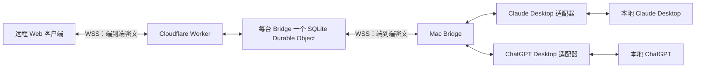

# Agent Bridge 开发方案

版本：前置验证阶段 v1.2  
资料核对日期：2026-11-09  
开发准入：**P0 尚未通过，不直接进入完整开发。** 官方资料中的支持不等于本机已验证。  
目标：通过远程 Web 操作本地 Mac 上的 **Claude Desktop（包含 Code 页）和 ChatGPT 桌面版**，支持现有会话浏览、继续对话及跨应用转发。

## 1. 可行性结论

**中继、配对与端到端加密有可行技术路径；Claude Code 路径的现有会话控制已打通，包含一条不需要关闭桌面的通道；ChatGPT 侧的 Codex 线程也已打通。已完成五轮预验证：第二轮打通浏览器↔Bridge 的 Noise 双向互通；第三轮在本机终端用真实模型验证了 Desktop Code 会话的枚举、读取、`--resume` 写入（同一文件、同一 session id、链尾线性续接、界面可见），以及桌面关闭期间写入后桌面重开会接续该轮；同时测出桌面运行期间的外部 transcript 写入会被静默绕过并分叉、改私有索引无效。第四轮找到并实测了**桌面运行时的注入通道**：每个 Code 会话进程在 `/tmp/cc-socks/<pid>.sock` 上监听跨会话消息，普通进程按行 JSON 投递即可让该会话开新一轮，实测两轮注入均落在同一 transcript 的链尾、无分叉、界面可见。第五轮补上 ChatGPT 侧与 AX：`~/.codex/ipc/ipc.sock` 可向桌面已打开的 Codex 线程注入一轮（实测回复 OK-IPC），AX 在授权后能枚举两端侧栏并完成“选已有会话→发送→拿到回复”（实测 OK-AX2）；Firefox Noise 19/19 与 snow 官方向量 5/5 通过。仍未成立：Claude 普通 Chat 无本地历史，且本机安装的窗口只有 Cowork／Code、没有 Chat 视图；ChatGPT 原生聊天只能走 AX；Safari 未验证。故 Claude Code 路径 P0 通过；ChatGPT 的 Codex 线程通过，原生 Chat/Work 仍只达“UI 自动化可用”，整体 P0 记为部分通过。**


| 需求 | 判断 | 实施边界 |
| --- | --- | --- |
| Cloudflare WebSocket 中继 | 可实现 | Worker＋SQLite Durable Object，使用 WebSocket Hibernation |
| 浏览器与 Mac Bridge 端到端加密 | 可实现 | 密钥只在端点，中继仅处理连接、鉴权、路由与密文 |
| 二维码／链接配对、信任期限、撤销 | 可实现 | Bridge 保存并强制执行授权，二维码本身另有短有效期 |
| Claude Desktop 的 Code 会话 | 枚举、读取、发送均已在本机实测通过（含桌面运行时的注入） | 发送走会话进程的 UDS 消息通道，属未公开协议，需按版本探测并保留回退 |
| Claude Desktop 普通聊天 | 本机不可达：无本地历史，安装也没有 Chat 视图 | 实测该版本窗口只有 Cowork／Code；Chat 需换安装／账号，或对可见界面做 AX |
| ChatGPT 桌面版的 Chat／Work 会话 | Codex 线程可编程发送；原生聊天只能 AX | IPC（`~/.codex/ipc/ipc.sock`）仅覆盖桌面已打开的 Codex 线程；ChatGPT 原生聊天无 handler，靠 AX 点击发送 |
| 两个应用的“所有工程、所有现有会话” | 不能提前承诺 | 必须证明完整分页、历史加载和指定会话发送均可用；仅能读取可见列表不算完成 |
| 选结果→目标应用→工程→会话→发送 | 可实现，依赖两端适配器 | 在 Bridge 本机读取并提交选中的内容，不依赖模型厂商原生分享功能 |
| 继续使用自定义模型网关 | 原则上可保持 | 实际消息仍由目标本地应用或其本地引擎发送；不会使应用原本不支持的网关自动变成可用 |

必须明确：**“连接到本地模型引擎”与“控制桌面应用原有会话”是不同的验收目标。** 不允许用新建 SDK 会话、另做一个 API 聊天界面或接入 Codex 来冒充本需求已经完成。

### 已核实的依据

- Cloudflare Free 支持 SQLite Durable Objects，可用作有状态 WebSocket 房间；空闲时使用休眠降低资源消耗。[DO 价格](https://developers.cloudflare.com/durable-objects/platform/pricing/) · [WebSocket 休眠](https://developers.cloudflare.com/durable-objects/best-practices/websockets/)
- Claude Code Agent SDK 提供 `listSessions()`、`getSessionMessages()` 等能力，可作为 Code 接入候选；这些 API 的存在不等于已证明覆盖全部 Desktop 会话。[TypeScript SDK](https://code.claude.com/docs/en/agent-sdk/typescript)
- Claude Desktop 与 CLI 各有会话列表；官方支持把部分 CLI 会话带到 Desktop，且存在认证方式和运行状态限制。Desktop 没有 CLI 的非交互输出模式。[Desktop 文档](https://code.claude.com/docs/en/desktop) · [会话管理](https://code.claude.com/docs/en/sessions)
- OpenAI 文档区分 ChatGPT 与 Codex。Codex app-server 提供线程控制，但不能据此当作 ChatGPT Chat／Work 的控制接口；OpenAI Conversations API 是 API 应用自身的会话状态接口，本次没有找到它能控制 ChatGPT 现有聊天的依据。[桌面产品](https://learn.chatgpt.com/docs/app) · [app-server](https://learn.chatgpt.com/docs/app-server) · [API 会话状态](https://developers.openai.com/api/docs/guides/conversation-state)

## 2. 产品范围与验收原则

### 第一版必须具备

1. Mac 安装一个 Bridge，接入用户已经登录的 Claude Desktop 和 ChatGPT。
2. Bridge 主动连接自建 Cloudflare 中继，不需要公网 IP、端口映射或官方远程控制服务。
3. Bridge 显示配对二维码和链接；远程浏览器配对一次，在授权期限内自动重连。
4. Web 展示可访问的应用实例、工程、会话、历史消息和当前运行状态。
5. 向指定现有会话发消息，接收回复；底层支持时提供停止、权限确认和补充输入。
6. 每条已完成的助手回复提供“复制”和“发送到其他客户端”。可选择单条结果、代码块或手动选中的文本。
7. 转发按“应用实例→工程／项目→会话”选择；没有工程概念时显示“未分组会话”。
8. Bridge 管理已配对浏览器，可设置期限、提前撤销，并显示在线／离线。
9. 自定义网关密钥、模型凭据、应用登录信息只保留在 Mac，不发送给中继或 Web。

这里的“客户端”默认指 **Mac 上的 Claude Desktop／ChatGPT 应用实例及其会话**；浏览器是控制端。一次配对授权访问该 Bridge 中开放的应用，无须对每个应用分别扫码。

### 第一版不扩展的范围

- 不做多租户 SaaS、付费账户、团队角色或复杂账户系统。
- 不自动循环执行“设计→编码→再设计”；每次跨应用发送由用户触发。
- 不默认支持附件搬运、语音、视频、屏幕远程桌面和大型产物同步；先保证文本、Markdown、代码块完整。
- Claude Cowork 若存在，作为独立能力检测，不因接通 Code 就宣称同时支持 Cowork。
- 不修改厂商应用，不向应用注入“分享”按钮；本需求中的操作按钮位于自己的 Web 客户端。

## 3. 系统架构



浏览器与 Bridge 的业务加密在两端完成。WSS 的 TLS 会在 Cloudflare 终止，但内层业务数据仍为密文。“中继不加解密”指它不持有、不使用业务端到端密钥，不是取消 HTTPS／WSS。

### Mac Bridge

- 运行在当前登录用户的会话中，统一管理配对、加密通道、适配器、会话索引、订阅、发送队列和转发。
- 通过本地接口或辅助功能操作实际桌面应用；模型请求继续沿应用已有配置发送。
- 本地保存授权与操作记录；私钥及存储加密主密钥进入 macOS Keychain。
- 开机登录后启动，可暂停远程控制；没有远程查看者时不持续上传全量历史。

### Cloudflare 中继

- Worker 提供静态 Web 资源、少量管理接口和 WebSocket 入口。
- 每个 Bridge 路由到独立的 Durable Object，维护一条 Bridge 连接和若干浏览器连接。
- 持久化最少量的路由／接入凭据摘要和有效期；不保存聊天内容，也不持久化离线业务密文。
- 转发不解释业务内容；不调用模型，不生成摘要，不搜索聊天，不接触应用凭据。
- 普通 Worker 的进程内 `Map` 不能保证两端连接进入同一实例，因此不能单独作为可靠会合机制。DO 负责这一点。

### Web 客户端

- 手机与电脑浏览器都能使用，以应用／工程／会话层级导航。
- 配对密钥在本地生成，业务数据在浏览器解密和渲染。
- 默认不持久化聊天正文；长期设备密钥按第 6 节保存。
- 同一 Bridge 的多个浏览器分别拥有授权与独立加密通道，撤销一端不影响其他端。
- 聊天内容按不可信输入渲染：禁用原始 HTML／脚本，清理 Markdown 链接与富内容，禁止默认加载正文中的远程资源；配置严格 CSP，不引入第三方分析脚本。

## 4. 桌面适配器：先证明能接入，再实现产品

### 4.1 适配优先级

按以下顺序寻找接入路径，不直接假设应用一定有可用的内部接口：

1. **官方公开、受支持的桌面控制接口或本地控制通道。**
2. **官方 CLI／SDK。** 仅在实测能对应原有桌面会话、保持认证与网关配置且不会产生并发写入时使用。
3. **macOS Accessibility。** 读取辅助功能树、选择工程／会话、填写输入框并发送；通过可访问性事件或受控轮询读取结果。
4. 已验证的本地历史存储只作为**只读发现与读取补充**。不直接修改应用数据库或 JSONL 来“发送”消息。

- **已实测的本地控制通道（仅 Claude Code 会话）：** 每个 CLI 会话进程（含 Desktop 内的 Code 会话子进程）都在 `/tmp/cc-socks/<pid>.sock` 上监听跨会话消息，按行 JSON 投递即可让该会话开新一轮；这是「不关闭桌面也能发送」的路径，见 4.2。

私有 IPC、内部 HTTP 接口、私有数据库格式属于版本相关候选，必须隔离在适配器内部，记录适用版本、失败方式与回退路径。不能假定 Electron 应用都允许开启 CDP，也不能默认对用户应用开放调试端口。

### 4.2 Claude Desktop

拆成 `claude-chat` 与 `claude-code` 两种会话类型，共用一个应用入口。

**Code 路径：**

- 本机只读样本中，8 个 Desktop Code 会话元数据里有 7 个含非空 `cliSessionId`，1 个为空；可关联到 CLI transcript 的路径。这里只证明部分历史的关联线索，未读取聊天正文、未证明全量覆盖，也未实测 SDK 读取。该字段属于私有格式，不作为稳定 API 承诺。
- **数据目录有两份，必须按正在运行的实例取：** 旧目录 `~/Library/Application Support/Claude/claude-code-sessions` 只有 8 个会话，最后写入停在 2026-10-18，是历史残留；当前 Claude Desktop 实例实际使用 `~/Library/Application Support/Claude-3p/claude-code-sessions`，共 41 个会话，最新写入与使用时间同步。任何按路径写死的实现只要指错目录，就会读到“会话比实际少很多”的假象（本文件第二轮即因此误判，见 11 节勘误）。启动时应探测实际数据目录，不能硬编码。
- 本机 Desktop 内置 Claude Code 标记为 `2.1.309`，独立 CLI 为 `2.1.319`；先验证版本兼容，不能默认使用 PATH 上的版本替代桌面引擎。
- 验证 Agent SDK 的会话枚举／读取能看到哪些 Desktop Code 会话。
- 用测试会话证明：桌面创建→Bridge 读取→Bridge 发送→桌面显示在同一会话→桌面继续→Web 同步。
- 确认会话的原始 ID 是否保持、是否发生复制／分叉、是否需要停止桌面中的运行者。
- **分叉检测只能比“用户提示／助手正文”记录，不能按任意 `parentUuid` 计数：** 正常 transcript 里工具调用会写出 `assistant(tool_use)` 与 `user(tool_result)` 两条同父记录（本会话实测 2 处），把它们当成分叉会误报。
- 只有已证明可共享控制时才连接原有控制通道；不能另起引擎与 Desktop 同时写同一个会话。
- **已实测的接管规则（见 11 节第三轮）：桌面未运行时，Bridge 可以 `--resume` 写入，桌面重开后从文件尾接续该轮，交接成立；桌面运行期间的外部写入则会被静默绕过并分叉，桌面的模型上下文里也没有该轮。改写桌面私有索引（热、冷）都无效，不要走这条路。** 因此 transcript 写入只作为「桌面未运行」时的交接手段：写入前确认桌面未运行，写入后再让用户重开桌面；桌面运行中一律走下面的 UDS 注入通道，不得对同一会话同时做 transcript 写入。
- Code 会话已证明可在桌面运行中无缝发送（见下条）。**普通 Chat 会话没有 UDS 通道，本地也没有历史，且本机安装没有 Chat 视图**（见 11 节第五轮补充）；能用的只有换用带 Chat 的安装／已登录会话，或对可见的 Chat 界面做 AX 自动化，不得宣传为无需本机界面的无缝控制。
- **运行中桌面的发送通道（第四轮实测通过）：** 目标会话的 CLI 进程在 `/tmp/cc-socks/<pid>.sock` 上监听，连接后写一行 JSON 即可注入一轮：
  `{"msg_id":"<uuid4>","type":"user","message":{"role":"user","content":"<cross-session-message from=\"uds:/tmp/cc-socks/<发送进程pid>.sock\" from-name=\"…\" from-mode=\"bypass\">正文</cross-session-message>"},"priority":"next","from":"uds:/tmp/cc-socks/<发送进程pid>.sock"}`
  接收端用 `LOCAL_PEERPID` 校验发送进程，要求 `from` 里的 socket 名等于该 pid，因此发送方必须绑定自己 pid 的 socket；`authRequired` 默认 `false`（本机无 key 文件）。**`from-mode` 必填**：目标为 `bypassPermissions` 时，不声明相同模式会被判 `hold`（暂存待批准，不开新轮），非 bypass 目标则缺省接受。实测两轮注入（发送进程 pid 88679／88937）都落在同一 transcript 链尾，`origin.kind=peer`、`turnOrigin=peer`，界面可见，无分叉。
- 该通道的限制必须写进适配器：属于未公开的跨会话协议（实测 CLI `2.1.317`／`2.1.319`），受 GrowthBook 开关控制，重启或升级后需重新探测 socket 与字段；模型侧看到的是一条 teammate 消息（带防提权说明），回复只写进 transcript，不回给发送方，Bridge 需要自己轮询 transcript 取结果；它也不覆盖普通 Chat 会话。
- **页面内 API 已确认存在但不可达：** `Claude.app` 渲染进程里有 `globalThis['claude.web'].LocalSessions`（`sendMessage`／`interrupt`／`getTranscript` 等），走 CDP 即可不关桌面直接发送；但应用把 `--remote-debugging-pipe` 列入禁用开关，并要求 `CLAUDE_CDP_AUTH`（Ed25519 签名的 v2 JWT，公钥硬编码）才放行。本机 `4.23118.0` 两者都有，故该通道对第三方封闭。若将来签名校验放宽，这条路应优先于 transcript 写入。
- 若 SDK 无法满足原会话控制，继续验证 Accessibility 路径。

**普通 Chat 路径：**

- 单独验证工程枚举、会话分页、历史消息加载、目标确认、发送和回复完成状态。
- 不把 Code 会话文件当成普通 Chat 历史。
- **已实测：普通 Chat 不在本机持久化。** 当前实例 `Claude-3p/IndexedDB` 中 `keyval-store`／`tipTapEditorState`／草稿共 1092 条记录，`conversation` 计数 0；`Claude/`（旧 1p）里只有一条星标会话的列表缓存（`chat_conversations_v2`，标题“notion 任务创建”＋摘要），最近列表请求返回 `403 account_session_invalid`；本地没有任何聊天正文。因此「解析 IndexedDB 取 Chat 历史」这条路不存在，不要再投入。
- AX 能读出 Claude 窗口与 Code／Cowork 侧栏，但**本机 `4.23118.0` 没有 Chat 模式入口**：Mode 组只有 `Cowork`／`Code` 两项（此前误认的无名 `AXGroup` 实测是选中 pill 的内层，与 `Code` 同坐标），Go 菜单同样只有这两项，`Window > Show Main Window` 不产生新窗口，点击 `Cowork` 可切到 Cowork 表面（`New task - Claude`）后切回 Code。应用包内虽有 `chat` 表面字符串，本机安装不可达；普通 Chat 只能换安装或已登录的 `claude.ai` 会话（需用户凭据，按约束不做）。

**网关：**

- 验证应用中已经可用的网关能被原样保留；GUI 启动的 Bridge 不一定继承终端环境变量。
- 若启用 CLI 子进程，显式解析本地有效配置并继承正确环境，不能要求用户把密钥填入远程 Web。
- Claude Desktop 对第三方推理有专门配置，不应假设导出 `ANTHROPIC_BASE_URL` 就能覆盖所有 Desktop 登录模式。[网关文档](https://code.claude.com/docs/en/claude-apps-gateway)
- 官方 Remote Control 在自定义 API 端点／Claude apps gateway 等配置下不可用，且其会话 transcript 会存入 Anthropic 服务端。它不能作为“保留自定义网关＋自建密文中继”的控制或备用路径。[Remote Control 要求与传输说明](https://code.claude.com/docs/en/remote-control)

### 4.3 ChatGPT Desktop

- 分别检测 Chat 与 Work，记录应用版本、账号／工作区、项目与会话层级。
- 若没有公开控制接口，主候选为 macOS Accessibility；它是需要实际验证的工程路径，不是已保证可用的 API。
- 必须处理侧栏虚拟列表、分页、会话搜索、重名工程／会话、未分组聊天及很长的历史。
- 本地缓存可能只包含部分已加载数据，不能作为“全部会话已同步”的依据。
- UI 需要稳定定位当前目标；找不到可靠会话标识时必须显示能力受限，不能按标题猜测发送。
- 不用 OpenAI Responses／Conversations API 重建聊天来代替实际 ChatGPT 桌面会话。
- 不用 Codex app-server 代替 ChatGPT Chat／Work 控制。即使它们在同一桌面应用内，接口覆盖范围仍需分别核实。
- 本轮只读检查发现内部 Unix socket 等线索，但未建立可控制 Chat／Work 的受支持接口。未发现 TCP 监听或未在已检查目录找到聊天库，都不能推出“绝对不存在接口／本地历史”；只记录检查范围和观察结果。
- **已实测的本地数据（第五轮）：** Codex 线程完全可读——`~/.codex/sqlite/state_5.sqlite` 的 `threads` 表 1464 行（标题、首条消息、`rollout_path`），`~/.codex/sessions` 2.0G 的 rollout JSONL／zst 含完整正文。ChatGPT 原生聊天只在 `~/.codex/sqlite/codex.db` 的 `local_thread_catalog` 留标题（`source_kind='chatgpt'` 6 行），正文不落盘，提交走 `https://chatgpt.com/backend-api` 的 `/f/conversation` SSE。
- **无 TCP／CDP／AppleScript：** 桌面进程无监听端口；Electron IPC 是进程内 MessagePort；`NSAppleScriptEnabled=false`。
- **AX 可用（第五轮实测）：** 授予辅助功能后，`maxDepth≥40` 的树能列出窗口、`AXWebArea`、侧栏项目与线程 `AXButton`（含标题）以及 `AXTextArea` 输入框。发送链路为：`Cmd+N` 新会话 → 设 `AXValue` → **真实鼠标点击“发送”按钮**。`AXPress`／`AXConfirm` 在该应用里对发送无效（返回 success 但不提交），必须用 `CGEvent` 点击。
- **AX 发送实测：** 新建会话“测试 Bridge AX 通道”发送“只回复 OK-AX”，得到回复；再点侧栏同名会话（已存在会话）发送“只回复 OK-AX2”，同一会话返回“OK-AX2”。窗口标题与侧栏按钮标题可用于目标确认。
- **Codex IPC 通道（第五轮实测通过）：** `~/.codex/ipc/ipc.sock`，4 字节小端长度＋UTF-8 JSON；目录 0700、socket 0600，**同 UID 任意进程可连，无 token／peer 校验**。流程：`initialize{clientType}` 取 `clientId` → `thread-owner-discovery{hostId:"local",conversationId}` 取 `handledByClientId` → `thread-follower-start-turn`（version 2，`targetClientId` 为 owner）投递 `input`。实测向已在桌面打开的线程注入“只回复 OK-IPC”，rollout 记录 `UserMessage` 与 `AgentMessage: OK-IPC`，`task_complete`，约 3.2 秒完成。
- **IPC 的边界：** 只能向**桌面已持有（stream role = owner）的 Codex 线程**发 turn；没有 `thread/list`／`thread/start`，无法枚举或新建；ChatGPT 原生聊天在该 IPC 中**没有 handler**，不能走这条路。桌面关闭或线程未打开时返回 `no-client-found`。协议未公开、随版本变化，必须探测后用。
- 若改用 Mac 上已登录的官方网页作为传输适配器，必须证明工作区、工程与会话 ID 相同且桌面同步；在能力报告中明确这是网页接入路径，不能静默切换实现。

### 4.4 UI 自动化的运行约束

- 辅助功能权限由用户在 macOS 本机授予；需要截图时才另外申请屏幕录制权限。
- UI 操作按**应用实例全局串行**，不只是按会话串行，避免两个浏览器同时切换同一窗口导致错发。
- 发送前后核对应用、工作区、工程和会话身份；用户本机切换窗口／会话时中断操作并重新确认目标。
- 有用户正在输入时不要覆盖输入框；先检测草稿与焦点，发现冲突返回明确状态。
- 优先直接设置可访问性控件值。必须借用剪贴板时保留原内容，仅在剪贴板版本未被用户改变时恢复。
- **AX 的返回码不等于生效：** 实测 ChatGPT/Codex 桌面端 `AXPress`／`AXConfirm` 返回 `0` 但输入框内容不变、消息未发出；必须用 `CGEvent` 真实点击发送按钮，并在发送后核对输入框已清空、会话标题或消息节点出现。`AXManualAccessibility` 在该应用返回 `-25205`，不能据此判定 AX 不可用（`maxDepth` 才是关键，实测需 ≥40）。
- 锁屏、未登录桌面、应用弹窗及 UI 结构变化可能令自动化不可用；返回 `requires_local_action`，不假装仍可后台操作。
- Mac 睡眠、关机或断网时 Bridge 不可达。需要无人值守时由用户选择本机防睡眠策略；Bridge 不具备隔空唤醒保证。

## 5. 数据模型、能力声明与同步

### 核心实体

| 实体 | 关键字段 |
| --- | --- |
| Host | `hostId`、显示名称、Bridge 版本、在线状态 |
| DeviceGrant | 浏览器设备公钥、`grantId`、权限、绝对到期时间、撤销状态 |
| AppInstance | `appInstanceId`、provider、版本、工作区标识、能力集合、接入模式 |
| Project | provider 原生 ID／稳定本地映射、名称、可选目录、分组类型 |
| Session | provider 原生 ID、项目 ID、类型、标题、更新时间、运行状态、读写能力 |
| Message | 原生消息 ID、角色、内容块、完成状态、消息版本 |
| Operation | `operationId`、发起设备、目标、操作类型、状态、provider 回执 |
| Transfer | `transferId`、源会话／消息、目标、内容摘要、发送结果 |

ID 不跨 provider 混用；索引键至少包含 `hostId/appInstanceId/sessionId`。工程目录与 UI 项目不是同一概念，统一数据模型应保留类型。

### 能力声明

每个适配器及必要时每个会话返回以下独立能力：

- 枚举工程、枚举会话、读取历史、监听更新、发送、停止、权限确认、新建会话。
- 枚举完整性：`complete`、`partial`、`unknown`，以及分页游标和限制原因。
- 接入模式：官方接口、SDK／CLI、UI 自动化或只读存储。
- 状态来源：原生事件、UI 状态或推断；推断结果不能当成确定事实。

不支持的操作在 Web 中禁用并说明原因，不能用空数组冒充“没有会话”，也不能把所有应用统一标记为完全支持。

### 同步策略

1. 配对后发送应用与能力信息，再分页加载工程和会话轻量索引。
2. 打开会话才读取消息，默认每页 50 条；长消息按块传输。
3. 优先订阅当前打开的会话。需要监听其他会话时只同步状态／索引变化。
4. provider 有事件则使用事件；只有 UI 轮询时，根据活动状态降频，并明确标记无法提供原生逐 token 流。
5. 生成中的增量在 Bridge 按约 100–200 ms 合并发送，完成事件立即发送。
6. 使用 `streamId + eventSeq + revision` 检测重复、缺口与过期更新。Bridge 保留有界重放缓冲；缺口无法补齐时重新拉取快照。
7. DO 休眠不影响连接语义；Bridge／网络重连后建立新加密通道，再根据业务游标恢复。不能在新通道复用旧密文。

## 6. 配对、授权期限与端到端加密

### 6.1 两个不同的期限

- **邀请有效期：** 默认 5 分钟，只能成功绑定一个新设备；过期或配对成功后立即作废。
- **设备信任期限：** Bridge 创建邀请时选择 1 小时、24 小时、7 天、30 天或手动撤销；默认 24 小时。期限从 Bridge 最终批准配对时起算，不能因重连自动延长。

Browser 清除站点数据、无痕窗口关闭或换浏览器后视为新设备，需要重新配对。

### 6.2 首次配对流程

1. Bridge 在本机生成长期设备身份，并注册中继房间。
2. 用户在 Bridge 选择信任期限并创建邀请。生成随机邀请 ID、独立中继准入令牌、256-bit 配对秘密和 Bridge 身份公钥。
3. 二维码携带 Web 地址，以及放在 URL fragment（`#` 之后）的邀请资料。配对秘密不得进入路径、query、访问日志、分析服务或 Referer；读取后立即从地址栏清除。
4. Web 在本机生成设备身份，通过独立准入令牌进入邀请通道；配对秘密不发送给中继。
5. Web 与 Bridge 执行经过标准实现的 Noise 握手，校验二维码固定的 Bridge 公钥，并证明持有配对秘密。
6. Bridge 默认自动批准持有有效邀请秘密的首个成功握手者，原子消耗邀请并创建授权。可提供“额外在 Mac 确认”选项，但不是默认依赖。
7. Bridge 通过已加密通道交付授权 ID、权限、到期时间和单独的中继重连凭据，双方固定对方设备公钥。
8. 配对结束后才允许同步应用和会话信息。单纯建立 WebSocket 不算配对成功。

配对链接本身就是短期授权入口。邀请被取消／超时后，不允许旧页面继续完成尚未提交的配对；并发兑换只允许一次成功。

### 6.3 加密方案

采用标准 Noise 协议，禁止只做“共享密码＋AES”或只依赖 WSS。建议基线：

- 首次配对：`Noise_XXpsk3_25519_ChaChaPoly_SHA256`，配对秘密作为高熵 PSK，另外校验 QR 固定的 Bridge 静态公钥。
- 已配对设备重连：`Noise_IK_25519_ChaChaPoly_SHA256`，双方固定静态公钥，每次生成新的临时密钥。
- 握手 prologue 绑定协议版本、预期 Host、通道标识与本次连接上下文，防止跨协议／跨房间混淆。
- 初次握手完成前及重连握手最终确认前均不发送业务指令，不使用 0-RTT 执行发送／转发。
- 使用标准实现管理双向 CipherState、nonce 和认证标签；独立通道不能共用状态，重连不能复用 nonce。
- 单个加密帧正文最多 32 KiB，给协议开销留足空间。Noise 消息本身上限 65,535 字节，超长正文必须分块，不可直接装进一帧。[Noise 规范](https://noiseprotocol.org/noise.html)
- 大消息分块包含加密的消息 ID、块序号、总长度与内容摘要，并限制重组内存和超时时间。

**依赖选型属于 P0 验证任务：** 候选包括使用 [snow](https://github.com/mcginty/snow) 的 Rust/WASM 共用加密模块；必须验证目标浏览器与 Mac Bridge 的兼容性、随机源、所需握手模式、官方测试向量及维护状况。不能把“实现了 Noise”写成“经过安全审计”。若候选不适配，选择另一标准实现，不自行重写握手算法。

**第二轮实测边界（2026-11-09）：** 已把 `snow 0.9.6` 编译为 `wasm32-unknown-unknown`，两端共用同一 WASM 模块（单一导入 `env.host_random`，RNG 由 JS `crypto.getRandomValues` 注入，不使用 `getrandom` 的 `js`/`wasm-bindgen` 路径），并在真实浏览器中完成互通：

- Chromium 157（Playwright）× Node 26 Bridge，`XXpsk3` 三消息握手与 `IK` 两消息重连握手均成功；二维码固定公钥在两端一致，响应端能读到发起端静态公钥；`IK` 连接复用同一静态身份。
- 双向正文：顺序 100 条、流水线 20 条（不等待回执）均按序；32768 字节明文的单帧可加解密（密文 32816 字节）；中文／emoji／组合字符无损。
- 拒绝路径：错误 PSK 在握手阶段失败；重放已消费的密文被拒绝；随机 64 字节垃圾帧被拒绝。
- 超过 65535 字节的 Noise 消息被实现直接拒绝，证实第 6.3 节“单帧 32 KiB、超长必须分块”的约束是硬限制而非建议。
- 仍属已知限制：snow 在本配置下要求显式提供本地静态私钥，不提供时构造握手失败（Bridge 与浏览器本来就持有长期身份，不影响方案）；仅测了 Chromium，Safari／Firefox 未测；官方测试向量、密钥固定后的篡改检测以外的异常路径仍未覆盖。

原型位置：`p0/noise-wasm/`（Rust FFI + Cargo.toml）、`p0/noise-interop/`（WASM glue、浏览器页、Bridge 侧 WS 服务）。

### 6.4 授权与撤销

- Bridge 是业务授权的最终判断者。每条命令、重连及订阅都检查设备身份、权限、期限和撤销状态。
- Bridge 本地定时终止到期设备的业务通道，并停止向其发送更新；不是等下一条消息才发现过期。
- 中继也可按到期时间清理连接，降低资源占用，但不能依靠中继实施最终安全控制。
- 撤销时关闭目标通道、取消该设备未分派的任务、删除重连凭据；已经提交给模型的任务不保证能够撤回。
- 不能撤回设备已经读到的内容。默认不持久化正文缓存可减少后续残留。
- 浏览器长期身份在 IndexedDB 中加密保存；用可持久化的不可导出 WebCrypto wrapping key 保护导出的 Noise 身份密钥。仍需明确：同源恶意脚本可以调用密钥或读取解密结果，不能据此声称能防 XSS。
- Mac 身份与本地加密主密钥放 Keychain；授权记录与操作日志放本地数据库，敏感内容字段加密。

### 6.5 中继能看到与不能看到什么

- 可看到 IP、连接时间、随机房间／通道标识、包长、频率、最少量准入信息。
- 不能看到工程名称、目录、会话标题、聊天内容、跨应用目标细节、模型密钥及业务身份私钥。
- 中继准入令牌与端到端 PSK／私钥是两类不同凭据；中继可以验证前者，但不能因此解密业务。
- 中继可以丢包、延迟或断开连接；端到端加密不保证可用性。
- **网页代码也属于可信端点。** 如果攻击者能修改网页 JavaScript，可在加密前窃取内容。高要求部署应把 Web 前端与中继放在独立管理边界，或自行固定可信前端版本；不能声称同源服务被完全控制后仍绝对安全。
- 加密保护浏览器↔Bridge 这一段；模型厂商或自定义网关仍按应用正常工作流程接触模型请求内容。

## 7. 中继协议与 Cloudflare 实现约束

### 7.1 路由和连接

- 一个不可猜测的随机 `hostId` 对应一个 DO，默认最多 5 个已配对浏览器并发在线。
- Bridge 保持一条上行 WSS，每个浏览器保持一条 WSS；Bridge 上行按随机 channel ID 多路复用。
- 每个浏览器与 Bridge 各自运行独立 Noise 通道；中继不可把一个浏览器的业务包广播给所有浏览器。
- DO 使用 `acceptWebSocket` 和 `webSocketMessage/Close/Error`；用 socket attachment 保存恢复所需的连接角色、通道映射、鉴权状态与期限。
- attachment 序列化上限为 16,384 字节，且随连接关闭丢失；只放少量连接元数据，较大或需跨重连保存的数据放 SQLite。
- DO 被休眠后内存会丢失。房间授权元数据放 SQLite；在线映射通过 `getWebSockets()` 与 attachment 重建，不能只依赖构造函数里的内存数组。
- 不在 DO 持有到模型厂商的出站长连接，不用 `setInterval` 保活整个对象；心跳优先用不会破坏休眠收益的 WebSocket 机制／自动响应。
- Bridge 和浏览器都必须处理部署、网络切换及平台维护导致的断连。指数退避加抖动，前台恢复时重新确认连接与授权。

### 7.2 接入鉴权

- 自用部署通过管理凭据注册 Bridge，禁止互联网上任何人无限创建房间。
- Bridge 持有独立房间管理凭据，控制邀请、浏览器重连凭据摘要和撤销；不得把管理凭据放进二维码。
- 浏览器原生 WebSocket 不能随意设置 Authorization 请求头，不能把“自定义 header”当成浏览器接入实现。
- 可采用 WSS 建连后首帧提交准入令牌的方式：未认证连接 5 秒超时，严格限制帧大小、挂起连接数和速率；未认证期间只允许鉴权，不转发业务。
- 固定允许的 Web Origin；Bridge 无浏览器 Origin 的连接通过独立角色凭据识别，不依赖 Origin 完成身份认证。
- 永久设备令牌不进入 URL。只保存令牌的安全摘要，生命周期不超过设备授权；精简日志不记录令牌或首帧正文。
- 房间 ID 和 channel ID 只用于路由，不是授权。即使这些值泄漏，也不能读取或执行业务。

### 7.3 业务协议

中继外层只携带版本、帧类型、随机通道标识及 Noise 数据；身份固定后的目标绑定在端点验证，不信任中继提供的“发送者”标签。

下列方法名是本项目定义，不是厂商 API：

| 类别 | 方法／事件 |
| --- | --- |
| 发现 | `host.info`、`app.list`、`project.list`、`session.list` |
| 历史与订阅 | `message.list`、`session.subscribe`、`session.unsubscribe`、`sync.resume` |
| 对话控制 | `message.send`、`turn.cancel`、`approval.respond` |
| 转发 | `transfer.prepare`、`transfer.commit`、`operation.get` |
| 设备管理 | `device.list`、`device.revoke` |
| 更新 | `session.updated`、`message.delta`、`message.completed`、`approval.required`、`capabilities.changed` |

所有业务请求、响应、错误、参数与事件都在密文中。请求包含 `requestId`；有副作用的命令另外包含稳定的 `operationId`。分页游标与会话 ID 不放在中继路径／query。

### 7.4 背压与离线

- 限制单帧、单业务消息、连接发送积压、分块重组大小及并发请求数；超限主动报错或断开慢连接。
- 高频 delta 可合并，完整结果与错误不能悄悄丢弃；恢复时用快照补齐。
- 浏览器离线时默认不积压远程发送；Mac 离线时中继不代存命令。用户恢复连接后再次确认发送。
- 已经开始的本地模型任务可以继续；重新上线读取最终状态，不保证重放所有 token。

## 8. 跨应用分享与发送

### 用户流程

1. 在已完成的回复下点击“分享”。
2. 选择“复制”或“发送到其他客户端”。
3. 选择目标应用实例，例如 Claude Desktop／ChatGPT。
4. 选择目标工程，再选择现有会话；未分组会话有单独入口。
5. 展示目标路径、正文预览及状态。默认转发当前选中的回复；可以手动修改。
6. 点击“发送”，向目标会话提交一条普通用户消息，并提供“查看目标会话”入口。

第一版不默认转发整个聊天历史；用户明确选择多条内容时才合并。第一版也不依赖厂商原生公开分享链接，不会把聊天发布到外网。

### Bridge 执行流程

- `transfer.prepare` 检查源内容可读、目标可写、授权未过期、目标未改变，返回有有效期的预览记录。
- `transfer.commit` 带上预览版本和稳定 `operationId`；提交前再次检查授权与目标身份。
- 将内容作为**普通用户输入／引用内容**发送，不提升为 system 或 developer 指令，不附带隐藏工具调用、系统提示词或模型内部推理。
- 原样保留 Markdown、代码块、换行和 Unicode；超过目标输入限制时提示用户缩减，不静默截断。
- 源与目标在同一台 Mac 时，Bridge 内部直接完成取值与发送；Web 不必把整个源历史再传回 Mac。
- 目标忙碌时默认提示“目标正在运行”，让用户稍后发送；只有已验证原生追加／排队机制时才开放对应选项。
- 新建会话作为适配器支持时的可选入口，不用“新建一个会话”代替用户选择的原有会话。

### 可靠性与幂等

- Bridge 在副作用前持久化操作 ID 与状态，所有客户端对同一操作查询同一结果。
- 目标发送成功必须有 provider 回执或已核对的新消息记录；“已填入输入框”不等于“已发送”。
- 如果进程在发送后、记录结果前崩溃，且 provider 不提供幂等键，状态应为 `delivery_unknown`。先查询目标历史进行核对，不能自动重发。
- Web 断线／超时只查询操作状态，不生成新 ID 盲目重试；UI 自动化尤其不能宣称具备跨进程崩溃的严格 exactly-once。
- 每个会话的写操作串行，UI 接入还需应用级串行；两端都不能因转发完成事件自动反向转发，避免循环。

## 9. 免费部署与资源预算

按 2026-11-09 核实的公开额度：

| Cloudflare 项目 | Free 额度／特点 |
| --- | --- |
| Workers 请求 | 100,000 次／天，账户级预算需考虑其他 Worker |
| Workers CPU | 普通 Free Worker 每次请求 10 ms；不要与 DO 的 CPU 限制混用 |
| DO 计算请求 | 100,000 次／天 |
| DO duration | 13,000 GB-s／天 |
| DO SQLite 读取 | 5,000,000 行／天 |
| DO SQLite 写入 | 100,000 行／天 |
| DO SQLite 存储 | 账户合计 5 GB |
| DO WebSocket 计量 | 入站消息按 20:1 折算计算请求；出站消息不收该请求费 |
| Workers Static Assets | 纯静态资源请求免费且不限量；调用 Worker 脚本的请求另计 |

来源：[Workers 限制](https://developers.cloudflare.com/workers/platform/limits/) · [DO 价格](https://developers.cloudflare.com/durable-objects/platform/pricing/) · [静态资源计费](https://developers.cloudflare.com/workers/static-assets/billing-and-limitations/)

**对个人少设备使用，采用上述策略有合理机会保持中继费用为 0；不能承诺无限量或永久免费。** Free 任一相关额度耗尽会导致相应请求失败；每日额度按 UTC 00:00，即北京时间 08:00 重置。模型费用、Mac 电费和自选域名不属于中继免费范围。

预算例子：若一段时间有 10 万个进入 DO 的 WebSocket 消息，按文档折算约 5,000 次 DO 计算请求，另外仍有建连、管理请求及其他资源消耗；这不是全产品容量保证。

实现要求：

- Web 静态资源直接由 Static Assets 服务，避免所有静态访问先执行 Worker。
- DO 只在注册、授权、撤销等低频变化时写 SQLite，不按 token 或心跳写数据库。
- 休眠连接恢复依赖 attachment 与持久化元数据，不靠循环定时器。
- 业务历史存在 Mac；不引入 D1、KV、R2、Queues 等第一版不需要的服务。
- 提供低频资源统计与限额提示，但不能假定能实时精确获知账户所有用量。
- 新仓库部署工具优先按当前 Cloudflare `cf` CLI 文档实施；若实施时已有 Wrangler 项目，沿用现有工具，不为文档里的示例更换工具链。

## 10. 推荐实现结构

在 P0 验证通过后再固定具体版本；默认以 TypeScript 为主，减少协议和数据模型的重复实现。

| 部分 | 推荐实现 | 理由 |
| --- | --- | --- |
| Relay | TypeScript Worker＋SQLite Durable Object | 满足有状态会合与免费额度要求 |
| Web | TypeScript＋轻量 SPA，移动端适配 | 无需 SSR；可使用 React＋Vite，由开发者核实当前版本 |
| Bridge 核心 | Node.js 当前 LTS＋TypeScript | 便于整合本地进程、SDK、WebSocket 和协议 |
| macOS 自动化 | 小型 Swift helper，经本地 stdio／Unix socket 与 Bridge 通信 | 使用 Accessibility，控制原生权限与应用定位 |
| 本地状态 | SQLite＋Keychain | 授权、索引、操作状态可恢复；密钥与正文分开管理 |
| 加密 | 两端共用的标准 Noise 实现；Rust/WASM 为候选 | 降低两端协议不一致风险，先验证再锁定 |
| 启动／安装 | 用户级 LaunchAgent，后续增加菜单栏外壳 | UI 自动化必须处于用户登录会话；不需要 root daemon |

Bridge 的本地管理页负责二维码、期限与设备管理。若采用 localhost HTTP，只监听 loopback，使用独立本机随机凭据并检查 Host／Origin 与 CSRF；不能让其他网页直接触发配对或撤销。

建议目录：

```text
apps/relay/                 Worker 与 Durable Object
apps/web/                   远程 Web
apps/bridge/                Mac Bridge 及本地管理入口
packages/protocol/          本项目消息类型、schema、版本协商
packages/crypto/            标准 Noise 实现的薄封装
packages/adapters/claude/   Claude Chat／Code 接入
packages/adapters/chatgpt/  ChatGPT Chat／Work 接入
native/macos-helper/       Accessibility 与 Keychain 等本机能力
```

不为了模块化先建立通用插件平台；两个适配器实现相同的必要能力契约即可。P0 可用最小原型，产品阶段再按职责整理。

## 11. 开发顺序与完成标准

### P0：桌面接入与密码库验证，最先执行

预计 2–4 人日，仅为探索预算，遇到桌面闭源限制可能得出无法满足的结论。

交付一个简短能力报告，记录两端版本、选定路径、枚举完整性、是否支持原会话读写、网关兼容性及锁屏限制；不要读取与验证无关的个人聊天。

验证分两步：先做本机只读检查与官方接口核对，再使用明确指定的测试工程／会话做真实读写。没有测试对象或本机权限时，记录缺失条件，不操作用户的个人现有聊天。

每项必须归入“已实测通过”“已实测不满足”“仅文档支持”或“受阻未验证”，附实际版本、复现方法、观察结果和证据；未做发送、并发、网关或加密互通实测时不能标记 P0 通过。结果应回填本文，修正接入路径与限制后再安排后续开发。

#### 2026-11-09 前置验证结果

已通过本机 Claude CLI 按 `researcher` 角色完成一轮只读／临时原型验证，主代理核对安装版本、复查原型并回填下表。**结论：P0 未通过。** CLI 请求模型别名为 `opus`，本机网关将其映射为不透明模型别名；本轮未核实网关后端实际模型身份，不据此宣称独立模型交叉验证。

对委派报告的复核口径：未发现公开接口不等于证明没有接口；缺少监听／数据库仅是被检查进程和目录的观察；本机样本不能代表所有会话；原生单向加解密不能当作双向或浏览器互通。

| 项目 | 实际观察 | 证据级别与影响 |
| --- | --- | --- |
| Claude Desktop | `/Applications/Claude.app/Contents/Info.plist`：版本 `4.23118.0`，Bundle ID `com.anthropic.claudefordesktop` | 已实测通过：仅证明安装与版本 |
| Claude Code CLI | 本机 `claude --version` 返回 `2.1.319` | 已实测通过：仅证明 CLI 可执行，不证明 Desktop 会话可共享 |
| Claude Desktop 内置 Code | Claude 读取内置引擎版本标记得到 `2.1.309` | 已实测通过：与独立 CLI 有版本差，尚未验证兼容 |
| ChatGPT Desktop | `/Applications/ChatGPT.app/Contents/Info.plist`：版本 `26.1103.41825`，build `25679`，Bundle ID `com.openai.codex` | 已实测通过：当前安装包沿用该 ID；必须按 Chat／Work／Codex 实际会话类型分别验证，不能仅凭包名判断覆盖范围 |
| 应用包只读检查 | 两个应用均存在 `Contents/Resources/app.asar`，只读解析归档目录成功 | 已实测通过：仅证明可检查安装包；未证明外部控制接口存在，不修改安装包 |
| Claude Code 历史关联 | 委派检查的 8 份本地会话元数据中，7 份含非空 `cliSessionId`，存在关联的 CLI transcript 文件 | 已实测通过：仅为部分样本的文件关联；正文读取、SDK 覆盖与完整枚举尚未证明 |
| 普通聊天控制接口 | 官方资料未找到覆盖 Claude Chat／ChatGPT Chat／Work 的完整第三方控制接口；静态检查只发现内部实现线索 | 受阻未验证：不把“未找到”写成“绝对不存在”；Accessibility 为待测候选 |
| Accessibility 授权检查 | 临时 Swift 进程调用 `AXIsProcessTrusted()` 返回 `false`；未请求授权、未弹窗 | 受阻未验证：当前临时验证进程不能作为已获授权的 UI 自动化端点；未来 Bridge 可执行文件仍需独立授权与重测 |
| 原会话枚举／读写 | 未读取个人聊天，未向真实会话发送，未新建测试会话 | 受阻未验证：需要明确测试对象与可用控制通道 |
| 网关保持、并发与忙碌状态 | 未修改应用配置、未向目标应用发送测试请求，未做桌面并发控制 | 受阻未验证：Claude CLI 的研究调用不算目标桌面应用的网关验证 |
| 官方 Remote Control 适用性 | 官方文档明确排除自定义 API 端点／Claude apps gateway，并说明 transcript 服务端存储 | 仅文档支持：确认不能用它代替本项目要求的自建中继路径 |
| Noise 原生最小原型 | `snow 0.9.6`：`XXpsk3`／`IK` 握手及单向正文加解密成功，主代理复跑退出码 0 | 已实测通过：仅限上述行为，不含双向、身份授权、异常路径和官方测试向量 |
| Noise wasm32 编译 | 临时原型生成 wasm32 测试程序，依赖 `getrandom 0.2` 的 `js` feature | 已实测通过：仅编译；浏览器导出／JS glue 与运行均未完成 |
| Noise Mac／浏览器互通 | 未在浏览器运行原型，也未完成浏览器↔Bridge 双向加密测试 | 受阻未验证：仍是 P0 门槛 |

#### 2026-11-09 第二轮验证结果（P0 剩余项）

执行环境：Darwin 27.0.0，Claude Desktop `4.23118.0`（内置 Code 引擎 `2.1.299` 与 `2.1.309` 并存），Claude Code CLI `2.1.319`，Agent SDK `0.3.319`，ChatGPT `26.1103.41825`（build `25679`）。

本轮在受限沙箱内执行：不能启动或控制 GUI 应用（Launch Services／Apple Events 被禁用），`ps` 不可用，也无法取得模型网关凭据。因此会话写入实测使用本地 mock `/v1/messages` 与隔离的 `CLAUDE_CONFIG_DIR`，**未向用户任何真实会话写入内容**；也**未读取任何私人聊天正文**。

| 项目 | 实际观察 | 证据级别与影响 |
| --- | --- | --- |
| Desktop Code 会话索引 | ~~`Claude/claude-code-sessions/…/local_*.json` 共 8 个会话，8/8 含非空 `cliSessionId`~~ **该数据来自已停用的旧目录，已勘误**；实际目录 `Claude-3p/claude-code-sessions/…/local_*.json` 共 41 个会话，41/41 含非空 `cliSessionId` | 已实测通过：字段齐全，但仍属私有格式 |
| SDK 会话枚举 | `listSessions()` 返回 126 条；41 个 Desktop 会话按 `cliSessionId` 命中 41/41，无遗漏 | 已实测通过（勘误后）：Desktop 侧可见会话的枚举是**完整的**；先前“6/8 命中”是旧目录样本导致的错误结论 |
| 未命中的 Desktop 会话 | 无。41 个索引条目在 `~/.claude/projects/<编码 cwd>/<cliSessionId>.jsonl` 下全部存在对应 transcript | 已实测通过（勘误后）：先前“2 个仅有元数据、无正文”的条目属于旧目录，对当前实例不成立 |
| 枚举遗漏（CLI 侧，非 Desktop 侧） | 139 个顶层 transcript 中 12 个不出现在 `listSessions()`：5 个较大（31 KB–1.4 MB，属 godot-demo／hot-web-clone／karaclone／medicine-management／rts-demo），7 个约 1 KB（`/private/var/folders/…/T/magpie-claude-work-501` 的临时会话）。12 个中 4 个仍可用 `getSessionInfo`／`getSessionMessages` 读取 | 已实测通过：`listSessions()` 对**非 Desktop 来源**的会话存在可复现遗漏，**枚举完整性只能声明为 `partial`**；工程实现必须补一层直接扫描 `~/.claude/projects` 的兜底，不能只依赖 SDK |
| 会话读取 | 对命中会话调用 `getSessionMessages()`：8 条消息（3 user／5 assistant），2 个 text 块 + 6 个 tool_use 块，合计 13978 字符，含 `uuid`／`parentUuid`／`timestamp`／`session_id` | 已实测通过：历史读取可用，工具调用块同样可读 |
| 追加写入 | `claude --resume <sessionId> -p …` 写入**同一文件、同一 session id**，新增 user／assistant 记录且 `parentUuid` 延续到既有链尾，未产生副本或新文件 | 已实测通过（mock 模型）：存储层追加语义成立 |
| 接管 Desktop 产物 | 把 Desktop 创建的 `b5565e2f…` transcript 复制到隔离 store 后 `--resume`，仍以原 session id 成功追加；SDK `query({options:{resume}})` 同样成功 | 已实测通过（mock 模型）：CLI／SDK 接受 Desktop 生成的 transcript 格式 |
| 并发写入 | 两个进程同时 `--resume` 同一会话：两者都返回成功，但两条新 user 记录的 `parentUuid` 完全相同，会话在链尾分叉成两个分支 | 已实测通过：并发写不会报错而是静默分叉，**应用级串行锁是必需项，不是优化项** |
| 桌面 UI 是否反映外部追加 | 见第三轮：真实 Desktop 会话被外部 `--resume` 追加后，Desktop 自己的索引文件未被改写 | 部分验证：见下方第三轮结果 |
| 真实模型路径 | ~~未验证~~ **见第三轮：已在用户终端用真实模型完成** | 已实测通过：`claude --resume` 真实返回模型答复，存储层证据不再只依赖 mock |
| ChatGPT 控制接口 | 无 TCP 监听；存在内部 Unix socket：`~/.codex/ipc/ipc.sock`、`/tmp/codex-app-tools/<uuid>.sock`、`/tmp/codex-browser-use/<uuid>.sock`、`$TMPDIR/com.openai.codex.*/SingletonSocket` | 受阻未验证：socket 无公开文档，未连接、未驱动；不能据此声称可控制 Chat／Work |
| ChatGPT 本地历史 | 未发现结构化会话库；`~/Library/Application Support/com.openai.codex` 仅 Crashpad，缓存仅 Sparkle 更新数据 | 受阻未验证：只覆盖已检查目录，不推出“绝对不存在” |
| Claude 普通 Chat 本地存储 | `~/Library/Application Support/Claude` 下 IndexedDB 约 20 KB、Local Storage 约 1.3 MB（LevelDB），无结构化会话库 | 已实测通过（只读观察）：普通 Chat 不能走“读本地历史”路径 |
| Accessibility | ~~`AXIsProcessTrusted()` 为 `false`，两应用均返回 `-25204`~~ **见第三轮：授权后已可读** | 已实测通过（授权后），但见第三轮的窗口／控件暴露差异 |
| 浏览器↔Bridge Noise 互通 | 见 6.3 节：Chromium 157 × Node 26，`XXpsk3`／`IK` 双向正文、32 KiB 帧、重放／垃圾帧／错误 PSK 拒绝全部通过 | 已实测通过：该项 P0 门槛已清除 |

#### 2026-11-09 第三轮验证结果（本机终端 + 真实模型）

执行环境：用户在**非沙箱**的本机终端执行，Accessibility 已对该二进制授权；测试会话为 Desktop 新建的 `/private/tmp/ab-p0-test`（`cliSessionId ad2ce5ea-1c60-4579-afbb-b6247f2e5127`，标题 `Greeting`），仅写入测试内容。

**勘误：上一轮的部分结论取错了数据目录。** 上一轮用的 `~/Library/Application Support/Claude/claude-code-sessions` 只有 8 个会话、最后写入停在 2026-10-18，是历史残留；当前运行实例实际读写 `~/Library/Application Support/Claude-3p/claude-code-sessions`，有 41 个会话并持续更新。因此“8 个会话／6 个命中／2 个无正文”全部作废，已按 41 个会话重测（结果见上表）。

| 项目 | 实际观察 | 证据级别与影响 |
| --- | --- | --- |
| Accessibility 授权 | 授权后 `AXIsProcessTrusted()` 与 `AXIsProcessTrustedWithOptions(prompt:false)` 均为 `true` | 已实测通过：AX 路径本身可用 |
| 窗口枚举 | 两应用 `kAXWindowsAttribute` 返回 `kAXErrorSuccess` 但窗口数为 0（ChatGPT pid 81424、Claude pid 81849，均为后台无窗口状态），应用根节点 children 各 4 个 | 已实测通过：仅能说明后台状态下无窗口；**窗口存在时的枚举与控件遍历仍未验证** |
| ChatGPT 控件树 | 设置 `AXManualAccessibility=true` 返回 `-25205`（属性不支持），导出 274 行，未出现 `AXWebArea` | 受阻未验证：ChatGPT 的会话正文/侧栏未暴露到 AX；Electron 的手动 AX 开关对它无效 |
| Claude 控件树 | `AXManualAccessibility=true` 返回 `0`，导出 303 行，包含 `AXWebArea` | 已实测通过：Claude 可通过 AX 暴露 Web 内容，是当前唯一可行的 UI 自动化目标 |
| 真实模型 resume 写入 | `claude --resume ad2ce5ea… -p "Bridge 接管测试：只回复 OK" --output-format json` → `result: OK`；同一文件行数 36 → 64，`sessionId` 保持 `ad2ce5ea…` 不变 | 已实测通过（真实模型）：**存储层接管 Desktop 会话成立**，不再依赖 mock |
| 写入后的链结构 | 从新 assistant 记录回溯父链共 27 环，线性延伸到 `hi` 起始记录；按 `parentUuid` 统计**无任何节点拥有两个子节点**，未分叉 | 已实测通过：单写者顺序追加不会破坏历史链 |
| Desktop 自身索引是否跟随 | 该会话索引 `local_2b3148a2…json` 的 `completedTurns` 仍为 1、`lastAssistantUuid` 仍是旧值 `3078e880…`、`lastActivityAt` 仍是 15:24:37；用户打开该会话后索引 mtime 更新到 15:35:59，但只写了 `lastFocusedAt`，计数与尾指针**依旧没被纠正** | 已实测通过（关键约束）：**Desktop 不会因为 transcript 被外部改写而刷新自己的索引，打开会话也不回填计数**。Bridge 不能用 `completedTurns`／`lastAssistantUuid` 判断是否有新消息，必须读 transcript 本身 |
| 模型选择来源 | 会话索引记录的模型是 `mythos-magpie-8067699270[1m]`，而 CLI 实际打印 `[claude-code:unrecognized_model] {"model":"group/dsgroup[1m]"}` 的告警后仍正常回答 | 已实测通过（限制）：resume 后的模型由 CLI 自身配置决定，**不会沿用会话原模型**。实现时必须把“当前模型”与“会话记录模型”分开呈现，不能声称等价接管 |
| 桌面 UI 是否显示该轮 | 用户在 Desktop 中打开该会话，**「Bridge 接管测试：只回复 OK」及助手回复正常显示**；打开发生在外部写入之后，索引计数未被回填仍能看到 | 已实测通过：外部追加对**渲染**有效。但注意：显示不等于采纳，见下一行的并发实测 |
| 桌面打开期间外部写入（并发） | Desktop 保持该会话在前台时，先由外部 `--resume` 写入 A 轮（`并发测试 A／OK-A`），再在桌面发送 `OK-B`。结果：A 的父链正确接在外部轮 `OK` 之后（深度 30），**B 的父链从 `你好，有什么可以帮你的？` 直接续出（深度 19），完全绕过外部轮与 A**，两者成为兄弟分支；桌面侧模型上下文里没有外部轮，故回复为「收到，但我不确定 “OK-B” 指什么」 | 已实测通过（决定性否定“同时续写”）：**桌面运行期间，外部写入会被静默绕过并分叉**；界面上看到外部轮并不代表桌面会采用它。是否完全不能交替，见后面“时间分离交接”两行 |
| 改写桌面索引能否改变续写点（桌面运行中） | 把索引 `lastAssistantUuid` 由 `a377f5c8`（桌面分支 B）改为 `3d6fe143`（外部分支 A 的末尾）、`completedTurns` 改为 3 后，在桌面发 `OK-C`：结果 C 仍接在 `a377f5c8` 之后，**改写无效**；桌面在该轮结束后（15:52:49）用自己的值 `92d3fd0d` 重写了整个索引 | 已实测通过（否）：**桌面运行中改写索引无效**——它按内存中的尾指针续写，并在自己每轮结束时回写索引。另查：整个 `Claude-3p` 下只有这一个持久化文件引用该会话 id，没有第二个指针存储（grep 仅命中该索引与其备份），所以仍需验证“桌面未运行时改写索引”这一场景 |
| 改写桌面索引能否改变续写点（桌面未运行） | 完全退出 Desktop 后再把 `lastAssistantUuid` 改为 `3d6fe143`（外部分支 A 末尾），重新启动后发 `OK-D`：结果 D 接在 `92d3fd0d`（桌面分支 C 的回复）之后，**仍未采用改写的指针**。此时 transcript 的文件尾恰好也是 `92d3fd0d` | 已实测通过（否）：**改私有索引不能改变续写点，冷启动也一样**，剔除“内存缓存”解释后，桌面要么不读该字段做续写、要么另按文件尾续写。**“改索引”路线就此排除**；真正要验证的是更简单的场景——桌面关闭期间由 Bridge 写入、桌面重开后是否接续（见下两行） |
| 时间分离交接（Bridge 写 → 桌面接续） | Desktop 完全退出后，外部 `--resume` 写入 `交接测试 E／OK-E`；随后启动 Desktop、打开同一会话、发送 `交接测试 F／OK-F`。结果：**F 的父链穿过 E 的回复 `a8c9a2db`**，桌面正常接续，模型上下文包含 E（回复即为 `OK-F`） | 已实测通过（正面）：**只要桌面未运行时写入，桌面重开后会接续外部轮**，无需改索引。这是可行的交接语义 |
| 交接前提与方向对称性 | E 写入前的链尾是桌面自己的 `OK-D`，Bridge 从文件尾续写成功；F 从 E 的回复续写也成功。反向（桌面写、Bridge 接）在 A/E 两次写入中同样成立 | 已实测通过：两个方向都按 transcript 文件尾续写；**冲突只发生在两者同时持有会话状态时** |
| 桌面轮次计数口径 | 上述全过程结束后索引 `completedTurns=5`，对应桌面自己写的 5 轮（你好／B／C／D／F），E 与 A 从未计入 | 已实测通过：`completedTurns` = 桌面写入轮数，不是会话总轮数 |
| Desktop 尾指针是否被外部写入推动 | 外部写入后 `completedTurns` 仍为 1；桌面自己发完 B 轮后变为 2、`lastAssistantUuid` 跳到 B 的回复 `a377f5c8` | 已实测通过：`lastAssistantUuid` 只跟随桌面自己的分支，外部写入既不推动它、改写它也不生效 |

#### 2026-11-09 第四轮验证结果（运行中桌面的注入通道）

排查方向：Desktop 主进程没有任何 TCP 监听；它与 Code 子进程之间只有 socketpair（fd 0/1/2 为 unix socket，不是 pty），外部无法注入；`~/.claude/daemon` 的 rendezvous 通道只覆盖 `--bg`／守护进程托管的会话（`app.asar` 里 `cc-daemon`／`control.sock`／`rendezvous` 出现 0 次）；Electron fuse 关闭了 `RunAsNode`／`NODE_OPTIONS`／`--inspect`；CDP 仍由 `CLAUDE_CDP_AUTH` 门禁。唯一没查的是每个 CLI 进程自带的 unix socket。

（勘误：早前把 `127.0.0.1:51433/51512/51590` 当成会话控制口是误判。这些端口是各会话 Bash 沙箱的 srt 代理，未带凭据的请求返回 `407 realm="srt"`；`/tmp/cc-socks/<pid>.sock` 才是消息口。）

| 项目 | 实际观察 | 证据级别与影响 |
| --- | --- | --- |
| socket 存在性 | `/tmp/cc-socks/` 下每个 claude 进程一个 `<pid>.sock`（`drwx------ gowinder:wheel`，socket 权限 600），无 key 文件；Desktop 会话 `71564`（cwd `/private/tmp/ab-p0-test`）同样有 | 已实测：Code 会话进程自带监听口，与桌面是否运行无关 |
| 协议来源 | CLI `2.1.319` 可读出：按行 JSON；`{"type":"user","message":{"role":"user","content":"…"},"priority":"next","from":"uds:/tmp/cc-socks/<pid>.sock"}`；接收端用 `LOCAL_PEERPID` 校验发送进程，要求 `from` 的 socket 名等于该 pid；`authRequired` 默认 `false` | 已实测（代码＋行为一致） |
| 首次非 CLI 进程注入（缺 from-mode） | 普通 Python 进程发出后会话**无反应**。查接收端策略：目标为 `bypassPermissions` 时，发送方必须在信封里用 `from-mode` 声明相同模式，否则判 `hold("no-mode-asserted")`，消息暂存待批准 | 已实测（失败）：缺字段不会报错，只会被扣下 |
| 补 from-mode 后注入（pid 88679） | 会话开新一轮，transcript 第 187 行 `type=user`，`origin.kind=peer`、`origin.verifiedPeerPid=88679`、`fromMode=bypass`、`turnOrigin=peer`；助手回复 `OK-UDS`（第 189 行） | 已实测通过：**普通进程可在桌面运行时注入并触发一轮** |
| 第二次注入（pid 88937） | 第 193 行同样结构，父链 `84366d26(system) → 254d5ee9(user) → f796df64(assistant: OK-UDS-b)` | 已实测通过：可重复 |
| 注入后的链结构 | 从第 200 行回溯父链共 67 环，依次经过 187/189/193/200，**单一线性链，无兄弟分支** | 已实测通过：注入不会像 transcript 写入那样分叉 |
| 界面可见性 | 用户在 Greeting 会话里直接看到 `Bridge UDS 通道测试：只回复 OK-UDS(-b)` 及回复 | 已实测通过：桌面渲染该轮 |
| 网关与模型 | 该轮请求走会话自身配置（`deepseek-v4.1-flash` 实际出字），不需要 Bridge 持有密钥 | 已实测：注入不改变认证与网关路径 |

**结论：** 运行中的 Desktop Code 会话存在可用的本地注入通道，且比分叉风险更低的 transcript 写入更适合作为主路径。限制条件同样明确：未公开协议、受 GrowthBook 开关控制、`from-mode` 必须与目标会话模式一致、模型回复只写入 transcript（不回给出入方，需自行读文件），且不覆盖普通 Chat。

#### 2026-11-09 第五轮验证结果（AX 与 Codex IPC）

四项并行验证：Claude 普通 Chat、ChatGPT Desktop、Noise 互通、AX。AX 前一轮的“不可用”结论被推翻——原因是导出深度 `maxDepth=8` 恰好截在 `AXWebArea` 之下，不是权限问题。

| 项目 | 实际观察 | 证据级别与影响 |
| --- | --- | --- |
| AX 授权 | 在用户终端运行 `~/bin/ax-probe`：`AXIsProcessTrusted: true`，Claude 与 ChatGPT 各 `windows=0(n=1)`；沙箱内同一探针返回 `-25204`／`AXIsProcessTrusted=false` | 已实测：AX 必须在终端执行；沙箱内的失败不能当作能力结论 |
| 深度修正 | `maxDepth=8` 时 Claude 只有 301 节点、WebArea 下为空；`maxDepth=40` 时 992 节点，出现完整侧栏 | 已实测：此前的“没有 WebArea 子节点”是导出参数错误 |
| Claude AX 枚举 | `AXWebArea title="… - Claude Code"`，侧栏 `AXButton` 逐条给出 Code 会话标题（hot-web-clone、005 python 模拟数值 v2、Craftstead 品牌官网首页…），输入框 `AXTextArea desc="Prompt"` | 已实测通过：Code 会话可仅靠 AX 枚举并定位 |
| Claude Chat 视图 | `4.23118.0` 的 Mode 组只有 `AXButton desc="Cowork"`／`desc="Code"`（无名 `AXGroup` 与 Code 同坐标，是选中 pill 的内层）；Go 菜单只有 Cowork／Code；`Show Main Window` 不产生新窗口；点击 Cowork 切到 `New task - Claude`、切回 Code 恢复原会话；普通 Chat 本地仍不落盘 | 已实测（否定）：**本机安装没有 Chat 视图**，Chat 需换安装／账号；AX 覆盖只对可见界面成立 |
| ChatGPT AX 枚举 | `AXWebArea title="制定 Craftstead 官网方案"`，侧栏项目（crossover、agent-bridge、出海）与线程 `AXButton` 带标题，输入框 `AXTextArea` | 已实测通过：项目／线程可枚举 |
| AX 发送（新会话） | `Cmd+N` 打开新会话（webArea 变 `ChatGPT`），设 `AXValue` 后点击“发送”，会话标题变为“测试 Bridge AX 通道”，出现用户消息与回复 `OK-AX` | 已实测通过：AX 可发送并拿到回复 |
| AX 发送（已存在会话） | 点击侧栏按钮选中“测试 Bridge AX 通道”，发送“只回复 OK-AX2”，同会话返回 `OK-AX2`，两条历史都在 | 已实测通过：可向指定原会话发送 |
| AX 调用细节 | `AXPress`／`AXConfirm` 显示 `0` 但不提交；真实 `CGEvent` 鼠标点击“发送”才生效；`AXManualAccessibility` 对 ChatGPT 返回 `-25205` | 已实测：实现必须用真实点击，不能信 AXPress 的返回码 |
| Codex IPC 握手 | `~/.codex/ipc/ipc.sock`：`initialize` → `clientId`；`thread-owner-discovery` → `handledByClientId`（success） | 已实测通过：同 UID 进程可连接，无 token |
| Codex IPC 注入 | `thread-follower-start-turn`（version 2）向已打开线程注入“只回复 OK-IPC”，返回 `status=inProgress`；rollout 记录 `UserMessage` 与 `AgentMessage: OK-IPC`，`task_complete`，3.2 秒 | 已实测通过：**无需 UI 自动化的编程通道**，作用于桌面原线程 |
| Codex IPC 边界 | 无 `thread/list`／`thread/start`；ChatGPT 原生聊天无 handler；线程未在桌面打开返回 `no-client-found` | 已实测（限定范围）：只覆盖 Codex 线程 |
| 普通 Chat 本地数据 | `Claude-3p/IndexedDB` 共 1092 条，`conversation` 计数 0；旧 `Claude/` 仅 1 条星标列表缓存，最近列表 `403 account_session_invalid`；正文不落盘 | 已实测（否定）：Chat 不能离线枚举或读取 |
| Claude 可本地读取范围 | Code 43 条（transcript）；Cowork 6 条（`local-agent-mode-sessions/local_*.json`，标题＋首条消息） | 已实测：非 Code 的本地可读会话只有 Cowork |
| Noise Firefox | Playwright Firefox 159 无头跑 XXpsk3／IK，19/19 通过（含 32 KiB 帧、流水线 20 条、重放拒绝、错 PSK 拒绝） | 已实测通过 |
| Noise 官方测试向量 | snow 0.9.6 `cacophony.txt`／`snow.txt` 中 WASM 支持的 NN／IK／XXpsk3 共 5 条逐字节通过；1347 条因未暴露模式跳过 | 已实测通过（范围有限） |
| Safari | `safaridriver --version` 正常，但 `safaridriver --enable` 需要管理员密码，WebDriver 报“Allow remote automation”未开启 | 未验证：需用户执行 `sudo safaridriver --enable` |

**结论：** Claude Code 与 ChatGPT/Codex 两端都已有可用的“向原会话发送”通道：Claude Code 走 UDS 注入，Codex 线程走 `ipc.sock`（编程）或 AX（UI，可覆盖 ChatGPT 原生聊天与其他视图）。仍不成立的是：Claude 普通 Chat 的本地枚举/读取、ChatGPT 原生聊天的编程发送（只有 AX），以及 Safari 互通。

#### 2026-11-09 第五轮补充（Claude Chat 视图）

解锁后直接操作 Claude 窗口复核 Chat 入口，`~/bin/ax-mode`（新增探针，按 Mode 组切换表面）：

| 操作 | 实际观察 |
| --- | --- |
| Mode 组结构 | 无名 `AXGroup @1354,274 119x26`、`AXButton desc=Cowork @1221,274`、`AXButton desc=Code @1354,274`；无名组与 Code 完全同坐标，实为选中 pill 的内层，不是第三个表面 |
| 切换控制组 | 点击 `Cowork` → webArea 变为 `New task - Claude`；再点 `Code, awaiting your input`（按钮名带状态后缀）→ 回到原会话 `… - Claude Code`，证明点击与匹配均生效 |
| 主窗口 | `Window > Show Main Window` 返回 0，窗口列表仍只有 `Claude`，不产生 Chat 窗口 |
| 菜单 | `Go` 菜单只有 `Cowork`／`Code`；`File` 只有 New Session／New Session in New Window／New Side Chat，均属 Code |

**结论：** 本机安装（`4.23118.0`，profile `Claude-3p`）没有普通 Chat 表面；`Side Chat` 是 Code 会话内的侧聊，不是 claude.ai Chat。Chat 要另换带 Chat 的安装与登录账号。另记一条运行约束：锁屏期间 AX 只返回菜单（窗口树不可见）、`screencapture` 报 `could not create image from display`，此类失败属环境状态，不能当作能力结论。

#### 2026-11-09 同类开源方案对照

查了四个公开项目，确认“控制运行中的官方桌面应用”没有现成可借鉴的通道，其中一条原本最有希望的路径已被官方封闭。

| 项目 | 做法 | 对“是否必须关闭桌面”的意义 |
| --- | --- | --- |
| `czhmartinez/claude-desktop-bridge` | 唯一真正操作 Claude Desktop 原生会话的项目。它不开 transcript，而是先 `ensureOrdinaryClaudeStopped()` 停掉普通实例，再用 `--remote-debugging-pipe` 自己拉起一个“受管”实例，通过 CDP 调用页面内的 `globalThis['claude.web'].LocalSessions`（`start`／`getAll`／`getTranscript`／`sendMessage`／`interrupt`／`setModel`／`getContextUsage`／`onToolPermissionRequest` 等） | **仍然要关闭桌面**，只是把“关掉”换成“由它自己重启一个受控实例”。而且它显式检测到新版要求 `CLAUDE_CDP_AUTH` 时直接报不兼容、拒绝绕过签名 |
| `kankancuige/claude-desktop-bridge` | 自建 Electron 客户端 + Node Gateway + `@anthropic-ai/claude-agent-sdk`，Session Pool 由自己管理 | 不控制官方 Desktop，会话从零开始，不适用 |
| `Mugyen/claude-bridge` | 零依赖 Node 中继 + 生命周期 hooks + MCP + skill；CLI 会话由 hooks 自动注册，Desktop 靠一次提示接入 | 桌面端靠“会话自己调用 MCP”参与，不是外部注入；不需要关闭，但也无法向未参与的空闲会话发送 |
| `DeliciousBuding/codex-browser-bridge` | 把 ChatGPT 桌面应用的 **浏览器通道**（named pipe／`/tmp/codex-browser-use`）封装成 MCP，再经 CDP 控制 Chrome/Edge | 控制的是浏览器，不是 ChatGPT 的聊天会话；且明确声明 macOS 未验证 |
| 本机实测补充（`Claude.app` 4.23118.0） | `app.asar` 内含 `claude.web`／`LocalSessions`（13 处），说明页面内确有会话 API；但 `--remote-debugging-pipe` 在禁用开关清单里，`CLAUDE_CDP_AUTH` 是**Ed25519 签名的 v2 JWT**，公钥硬编码在应用内，缺签名令牌即无法开启 | 这条“不关闭桌面”的通道对第三方封闭，不可用 |

**结论（已按第四轮结果修订）：** 上述项目都没走到 `/tmp/cc-socks` 的跨会话通道，所以它们要么关闭桌面，要么另起受管实例。本机实测证明还有第三条路，且不需要关闭桌面：**直接向运行中 Code 会话进程的 UDS 投递 peer 消息**（见上一节）。因此“必须关闭桌面”不再是硬约束，只是 `--resume` 写 transcript 这一条路的前提。三条路的取舍：

| 路径 | 桌面是否需关闭 | 结论 |
| --- | --- | --- |
| ① CLI `--resume` 写 transcript | **必须**（否则静默分叉） | 保留为**回退**：桌面未运行时的交接手段 |
| ② 自带受管实例 + CDP | 要（换成自起重启） | 不可用：`CLAUDE_CDP_AUTH` 对第三方封闭 |
| ③ UDS peer 注入（本机实测） | **不需要** | **主路径**：桌面运行时直接注入，链不断裂、界面可见 |

代价是 ③ 属未公开协议，必须按 CLI 版本探测（先确认 `<pid>.sock` 存在再投递），并保留 ① 作为回退。

**当前决定：Claude 路径 P0 通过；ChatGPT 侧部分通过；整体 P0 记为部分通过。** Claude Code：Desktop 会话可枚举（41/41）→ 可读取 → **桌面运行时经 UDS 注入并开新一轮**（pid 88679／88937，父链 67 环单链无分叉）→ 桌面关闭时 `--resume` 写入可被重开后接续。**不再要求关闭桌面。** 规则：同一会话同一时刻只允许一个写入者——运行时只走 UDS，绝不同时做 transcript 写入。ChatGPT：Codex 线程可经 `~/.codex/ipc/ipc.sock` 注入并收到回复（实测 OK-IPC）；AX 可在已授权、窗口可见时枚举两端侧栏并向指定已有会话发送（实测 OK-AX／OK-AX2），但属 UI 自动化。Claude 普通 Chat 无本地历史，本机安装也没有 Chat 视图（只有 Cowork／Code）；ChatGPT 原生聊天无编程通道，只能 AX。

剩余阻碍：**①三条通道（UDS、Codex IPC、AX）都不是公开稳定 API，必须做版本探测、回退与安全失败；②Claude 普通 Chat 的历史只在云端，离线不可枚举，且本机安装无 Chat 视图，需换安装／已登录会话或对可见界面做 AX；③ChatGPT 原生聊天只有 AX 一条路，且要求窗口前台、未被最小化；④Safari 互通未验证。**

下一轮最小验证条件：专用 Claude Chat 与 Code 测试会话、专用 ChatGPT Chat／Work 测试会话（按账号实际提供的类型）、准确的目标工程／工作区，以及用户已授权的最小 Accessibility helper。Code 会话测试前明确单写者／停止交接；不要求用户交出模型密钥。浏览器加密原型仅使用临时生成的数据和密钥。

**仍需在本机终端（非沙箱）执行的部分：**

1. ~~授予“辅助功能”权限并重跑 AX 探针~~ —— **已完成（第五轮）：`AXIsProcessTrusted()=true`，两应用窗口与侧栏均可枚举，`maxDepth=40` 是必要参数；AX 发送也已实测（OK-AX、OK-AX2）。** 仍缺：Claude Chat 视图下的枚举（本机安装没有 Chat 入口，见第五轮补充）。
2. ~~真实模型 `claude --resume`、界面显示、并发与交接~~ —— **已完成（见第三、四轮）：桌面运行时经 `/tmp/cc-socks/<pid>.sock` 注入可直接开新一轮（两次实测，单链无分叉）；桌面关闭时用 `--resume` 写入、重开后接续；同时运行做 transcript 写入会分叉；改私有索引无效；页面内 `LocalSessions` API 被 `CLAUDE_CDP_AUTH` 门禁挡住。** 剩下的是实现层设计：**按进程查找目标会话的 socket → 投递 peer 帧 → 轮询 transcript 取回复**，并保留“桌面未运行”时的 `--resume` 交接回退；两条路径不得同时作用于同一会话。运行时若 `<pid>.sock` 不存在或投递后 transcript 无新增，安全失败并报错，不退回盲写。
3. ~~ChatGPT：用 AX 树导出侧栏与会话标题，确认能否稳定定位到指定会话~~ —— **已完成（第五轮）：AX 树可列出项目与线程标题，点击侧栏按钮可定位并用真实鼠标点击发送，实测收到 OK-AX2。** 限制：窗口必须前台且未最小化，属 UI 自动化。
4. ~~补充 Safari／Firefox 的 Noise 互通，并跑官方测试向量~~ —— **Firefox 与官方向量已完成（19/19、5/5）；Safari 仍缺**，需用户执行 `sudo safaridriver --enable` 或手动打开一次页面核对 19 行 PASS＋`DONE`。

必须用用户允许的测试工程和会话验证：

1. Claude Desktop：先证明普通 Chat 的可靠枚举、历史读取和目标定位；Code 分别验证历史关联／读取与原会话写入／接管，证明单写者或交接语义，再确认两种会话均能准确回写。**Code 的枚举／读取／真实模型下的追加与界面显示均已验证；“桌面关闭时写入、重开后接续”成立（第三轮）；“桌面运行时经 UDS 注入并开新一轮”也已成立（第四轮，两次注入均单链无分叉）。前提：单写者，运行时只用 UDS 注入、不同时做 transcript 写入。普通 Chat 的枚举／读取仍未验证。**
2. ChatGPT Desktop：先证明 Chat／Work 的工程／会话枚举、分页、长历史和稳定目标定位，再向专用测试会话发送，并在桌面中确认；不能以 Codex app-server 验证替代。**已部分完成（第五轮）：Codex 线程可枚举（IPC／AX）、可读取（rollout）、可注入（`thread-follower-start-turn` 实测 OK-IPC）；ChatGPT 原生聊天只能 AX 发送（实测 OK-AX／OK-AX2），其历史不在本地、未验证长历史与分页。**
3. 含历史较多、侧栏未加载、重名及未分组的样本，确认列表完整性与长历史加载。
4. 原有网关配置下消息仍通过预期路径发送；不上传网关凭据。
5. 两端交替发送、目标忙碌、应用重启、UI 变更、Mac 锁屏时行为明确，不写坏历史或发错会话。
6. ~~选定 Noise 实现在 Mac 与目标浏览器双向互通~~ —— **Chromium（第二轮）、Firefox（第五轮 19/19）、snow 官方向量（5/5）已通过；Safari 仍未验证**，不能以现有结果代替全平台结论。

**关卡：** 如任一核心应用只能看到当前屏幕或不能向指定原会话可靠发送，必须明确报告“尚不满足原需求”。**当前判定：Claude Code 通过（UDS 注入）；ChatGPT/Codex 线程通过（IPC 注入实测 OK-IPC）；Claude 普通 Chat 在本机安装中无视图（第五轮补充）；ChatGPT 原生聊天仅达 UI 自动化发送（AX 实测 OK-AX2），在“可靠”意义上仍不满足——目标定位依赖窗口可见与鼠标点击。** 因此整体不能宣称通过本关卡；可以继续完善可独立成立的中继／加密原型与 Claude/Codex 通道，但不能把受限桌面接入包装成完成品；改变核心范围需交由用户决定。

### P1：中继、配对与授权

预计 3–5 人日。

- Worker＋DO 部署在 Free 计划，两个独立网络下的浏览器与 Mac 可连接。
- 首次二维码配对、独立设备密钥、重连、邀请过期、设备到期和撤销完整工作。
- 服务端日志及存储中不存在测试聊天明文、端到端密钥或网关凭据。
- 篡改、重放、错误公钥、错误 PSK、跨通道投递均不能产生有效业务操作。
- DO 休眠唤醒和 Worker 重部署后能恢复连接；不依赖常驻内存。

### P2：真实会话浏览与控制

预计 5–10 人日，依赖 P0 结果。

- 两个目标应用均接入真实测试会话；准确显示工程、历史、状态及能力限制。
- 浏览器发送与桌面发送能在同一会话对应，增量／快照、断线恢复正常。
- 测试多个浏览器并发，应用级 UI 锁与会话写入队列不会导致错发。
- 权限请求仅在适配器真正支持时展示，保留应用原有权限语义，不一键跳过安全确认。
- Web 不提供任意 shell、任意路径读取或原始厂商 RPC 转发；仅开放已实现的业务动作。

### P3：跨应用转发

预计 2–4 人日。

- 完成“ChatGPT 设计结果→Claude Code 指定工程会话→编码回复→ChatGPT 指定会话”的真实闭环。
- 单条结果、代码块、长文本、Unicode 与 Markdown 保真。
- busy、目标删除、授权过期、提交中断、重复点击和未知投递状态都得到明确结果。
- 转发的正文就是用户预览确认的版本，不夹带额外历史或隐含指令。

### P4：安装与稳定性

预计 2–4 人日。

- 用户级安装、登录启动、本地权限引导、版本检测、适配器失效提示与卸载可用。
- 在正常负载与长时间空闲下观察 DO 休眠、用量和重连，确认免费预算有余量。
- 多次应用重启、网络切换、浏览器后台恢复及 Bridge 重启后数据状态一致。
- 发放安装包前完成依赖与构建产物检查；对外分发的签名／公证及开发者账号成本单独评估，不计入 Cloudflare 中继成本。

**估算总计：14–27 人日，不含厂商应用兼容性障碍引发的额外工作。P0 未通过时不能以此估算承诺完整交付。**

## 12. 交给 Claude 的执行约束

1. 先执行 P0，不要先花时间实现完整 UI。首先证明能控制这两个目标桌面应用的原有会话。
2. 以本文为实施要求，不直接编造厂商 API、本地数据库路径或 IPC 协议；按实际安装版本和官方资料核实。
3. 所有底层 API 和配置语法以实施时官方文档及已安装版本为准，锁定依赖与应用兼容范围。
4. 每阶段在其验收条件满足后继续；如遇缺失能力，保留可用功能并准确说明限制，不能静默替换为 CLI 新会话或另一产品。
5. 全程保证中继不接触业务明文与端到端私钥；不要把“WSS 已加密”当成端到端加密完成。
6. 配对到期与撤销由 Bridge 强制实施，覆盖已有订阅、重新连接和正在排队的写操作。
7. 只有明确目标身份后才能发送；优先报冲突，不能猜测会话或盲按回车。
8. 不直接写厂商历史文件，不让多个引擎并发拥有同一会话，不自动重试状态不明的发送。
9. 保持自用单用户架构，不擅自增加登录 SaaS、付费服务、附件存储或自动代理协作系统。
10. 第一版是否完成，最终以**两个目标应用原有会话上的真实双向交互与跨应用转发**为准，不以中继上线或演示聊天界面为准。
11. 不得用官方 Remote Control／云端会话代替自建中继，或用 Codex thread 代替 ChatGPT Chat／Work；前置只读检查不读取私钥、Cookie 或无关个人聊天，副作用实测使用专用会话。
