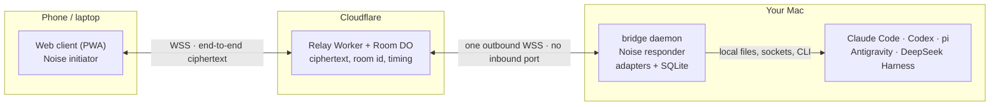

# Agent Bridge

An open-source, self-hosted bridge that lets you drive the coding agents already running on your Mac — Claude Code, Codex, pi, Antigravity, DeepSeek Harness — from your phone or any browser.

The Mac dials out to a relay. **Nothing listens on an inbound port**, no tunnel is installed, and no firewall rule is needed. The relay forwards opaque ciphertext: it never holds a key, so the bytes that leave your Mac are only readable at the far end of the pairing.

| Fact | Value |
| --- | --- |
| Latest release | **0.11.10** (2026-11-23) |
| Pre-release | **0.11.11-rc.1** (2026-11-26) — adds the Codex · App Server hosted engine |
| Host platform | macOS 13 or newer, Apple Silicon and Intel in one universal build |
| Download | [AgentBridge.dmg](https://github.com/gowinder/agent-bridge/releases/latest/download/AgentBridge.dmg), ≈ 89 MB |
| Interface languages | 8 — 中文 (source), English, 日本語, 한국어, Español, Français, Deutsch, Português |
| Agent entries | 9 — 8 adapters that mirror sessions already on the Mac, plus 1 hosted entry that starts the agent itself |
| Hosted engines | 3 — Claude Code, pi, Codex · App Server (the last one only in 0.11.11-rc.1) |
| MCP server | 9 tools over stdio, Node 22 or newer |
| License | MIT |

- Web client: <https://agent-bridge.craftstead.app>
- FAQ: [FAQ.md](FAQ.md)
- Detailed guide: [docs/GUIDE.md](docs/GUIDE.md)
- Changelog: [CHANGELOG.md](CHANGELOG.md) · [Releases](https://github.com/gowinder/agent-bridge/releases)

## What you get

- **9 agent entries in one web client.** 8 adapters read and drive sessions that already exist on the Mac; the 9th (hosted) starts the agent itself. DeepSeek Harness can also start a headless run in a project directory.
- **3 hosted engines the browser can start.** Claude Code, pi, and — from 0.11.11-rc.1 — Codex · App Server, with the Mac owning the process.
- **8 interface languages** in both the web client and the menu bar app, following your browser or system language and switchable by hand.
- **Real approval buttons for hosted sessions.** `Allow` / `Deny` prompts arrive in the chat and go back to the agent as a protocol answer.
- **0 inbound ports.** One outbound WebSocket from the Mac; no tunnel, no port forward, no relay-visible plaintext.
- **2 independent remote-devtools switches** (read-only file browser, one-command-at-a-time terminal), both off by default and both with a TTL.
- **9 MCP tools** so another agent can drive your hosted sessions over stdio, without opening anything on either side.

## Contents

- [How it works](#how-it-works)
- [Supported agents](#supported-agents)
- [Install](#install)
- [First run](#first-run)
- [Everyday use](#everyday-use)
- [Remote devtools](#remote-devtools)
- [CLI reference](#cli-reference)
- [Configuration](#configuration)
- [Security model](#security-model)
- [MCP server](#mcp-server)
- [How it compares](#how-it-compares)
- [FAQ](#faq)
- [Limitations](#limitations)
- [Development](#development)
- [Deployment](#deployment)
- [License](#license)

## How it works



1. `bridge init` creates a room on the relay and stores the room id, a bridge token and a Noise static identity locally.
2. `bridge serve` — or the menu bar app — opens one outbound WebSocket and keeps it open, reconnecting with 1 s → 30 s backoff.
3. `bridge invite` mints a **one-time** invite locally. Only its SHA-256 hash reaches the relay, and the token itself travels in the URL fragment, which browsers never send to a server.
4. The browser runs a Noise `xxpsk3` handshake with the Mac (PSK = HKDF-SHA256 of the invite token and room id). Both sides show a **6-digit code** derived from the two public keys; you compare it and confirm.
5. The device's Noise public key is stored on the Mac. Later connections use the `ik` pattern: no token needed, and a stolen relay cannot impersonate either side.
6. Payloads are Noise transport messages inside binary relay frames. The relay forwards **16-byte channel ids** and never parses a payload.

The web client polls — 5 s in a chat or list view, 10 s for the background session watcher — instead of subscribing to pushed deltas. Web Push/VAPID still delivers an alert when the tab is closed.

## Supported agents

Each adapter is a separate module in `apps/bridge/src/adapters/`. Capability differs because every agent stores and accepts messages differently. Two entries can create from the browser: the hosted one (3 engines) and DeepSeek Harness (one headless run in a project directory).

| Key | Display name | List / read | Send | Create | Notes |
| --- | --- | --- | --- | --- | --- |
| `hosted` | Bridge hosted | complete | ✅ | ✅ | Spawns the agent itself; 3 engines; approvals work end to end |
| `claude-code` | Claude Desktop · Code | partial | ✅ | ❌ | Drives the running session over its local UDS; otherwise wakes the desktop with a deep link |
| `claude-code-cli` | Claude Code · CLI | partial | ✅ | ❌ | `/tmp/cc-socks` injection while running, else `claude --resume -p` |
| `codex` | ChatGPT Desktop · Codex | partial | ✅ | ❌ | Only the thread open in the Codex panel; needs the ChatGPT app running (`~/.codex/ipc/ipc.sock`); native ChatGPT Chat/Work is out of scope |
| `codex-cli` | Codex · CLI | partial | ✅ | ❌ | `codex queue` while running, else `codex exec resume` |
| `antigravity` | Antigravity CLI | partial | ✅ | ❌ | `agy --conversation <id> --print`; cannot send while that session is running |
| `antigravity-desktop` | Antigravity Desktop | partial (read needs the desktop app running) | ❌ | ❌ | Read-only |
| `dsh` | DeepSeek Harness | partial | ✅ | ✅ | Resumes a `headless` profile; can also start one headless run in that project directory |
| `pi` | pi | complete | ✅ | ❌ | `pi -p --session <file>` for one resumed turn |

"Partial" is the adapter's own `Completeness` declaration (`complete | partial | unknown | unavailable`), not a bug: none of these agents publishes a stable session API, so list and read may miss tool output, attachments or historical turns. Per-adapter data sources and send mechanisms are in [docs/GUIDE.md](docs/GUIDE.md#7-adapters).

### Hosted engines

The `hosted` entry starts one process per session and keeps its stdin, which is why it is the only entry with end-to-end approval prompts.

| Engine | Availability | Process | Notes |
| --- | --- | --- | --- |
| Claude Code | all 0.11.x releases | `claude -p --input-format stream-json --output-format stream-json --permission-prompts host` | Default engine |
| pi | 0.8.0 or later | `pi --mode rpc --session-id <id> --approve` | Resumes by session file after a `/new` |
| Codex · App Server | **0.11.11-rc.1 (pre-release)** | `codex app-server --listen stdio://` | Official Codex protocol over stdio JSON-RPC; the desktop app does not need to run; sandbox `workspace-write`, approval `on-request`; one thread per session in `~/.codex/sessions`, resumed with `thread/resume` |

## Install

### DMG (recommended)

macOS 13 or newer, Apple Silicon and Intel in one universal build, ≈ 89 MB. The bundle contains the bridge CLI, its compiled output and a Node runtime, so nothing else needs to be installed.

1. Open [AgentBridge.dmg](https://github.com/gowinder/agent-bridge/releases/latest/download/AgentBridge.dmg).
2. Drag `AgentBridge.app` into `/Applications`.
3. Launch it. The app lives in the menu bar and has no Dock icon.

Release builds are signed and notarised only when the Apple secrets are configured; otherwise macOS blocks the first launch. On macOS 15 or newer the right-click → Open shortcut is gone: dismiss the dialog, open System Settings → Privacy & Security and click "Open Anyway" at the bottom. On macOS 14 and earlier, right-click the app → Open. Either way this also works:

```sh
xattr -dr com.apple.quarantine /Applications/AgentBridge.app
```

### From source

```sh
git clone https://github.com/gowinder/agent-bridge.git
cd agent-bridge
npm ci
npm run build:wasm -w @craftstead/crypto   # Rust Noise module → packages/crypto/wasm/noise.wasm
npm run build           # tsc -b across all workspaces
npm run check           # type check, including the web client
npm test                # build + node:test suite
```

`build:wasm` needs a Rust toolchain with the `wasm32-unknown-unknown` target:

```sh
rustup target add wasm32-unknown-unknown
```

Then either run the daemon directly (`npm run bridge -- <command>`) or build the menu bar app with `npm run menubar` (add `AGENT_BRIDGE_ARCHS="arm64 x86_64"` for a universal binary).

### Windows or Linux?

The host app is macOS-only today. [Vote for Windows/Linux support](https://github.com/gowinder/agent-bridge/issues/253) so we build for real demand.

## First run

The menu bar app does all of this for you; the CLI equivalents are shown for headless machines.

```sh
# 1. Create a room on the relay and write local state
npm run bridge -- init --relay https://agent-bridge.craftstead.app \
                        --web   https://agent-bridge.craftstead.app \
                        --name  "My Mac"

# 2. Run the daemon (the menu bar app does this itself)
npm run bridge -- serve

# 3. Mint a one-time invite, valid for 10 minutes
npm run bridge -- invite --ttl 600
```

`init` refuses a non-HTTPS relay unless it is a loopback address, and it health checks `/v1/health` before writing anything.

`invite` prints a link of the form:

```
https://agent-bridge.craftstead.app/#/pair?relay=…&room=…&invite=…
```

Open it on the phone. The pairing screen shows a 6-digit code; the same code is printed in the terminal and shown in the menu bar app. Confirm it on both sides and name the device. The invite is single-use, and a room can hold any number of devices.

If a room was already claimed by a different Mac, the relay refuses the new bridge: the first bridge to claim a room id owns it (trust on first use), and replacing it requires clearing the room on the relay side.

## Everyday use

The web client has three levels: **Clients** (`#/clients`, one card per installed agent with live session counts) → **Projects** (`#/clients/:appId/projects/:projectId`, sessions grouped by working directory) → **Session** (`…/sessions/:sessionId`, the conversation, a context gauge, a composer, attachments and an optional task rail).

In a session you can read the transcript, send a message, answer an approval prompt, rename the session, request a native compact (or copy `/compact` when the agent has no native compact), and — if the Mac owner enabled remote devtools — browse project files and run a single shell command. The rail shows the environment, context-window usage, MCP servers and background tasks wherever the adapter exposes them.

### Hosted sessions

The bridge owns the agent process, so tool-permission questions arrive as real prompts in the chat with **Allow** / **Deny** buttons, and the answer goes back as a `control_response`. Transcripts land in `$AGENT_BRIDGE_HOME/hosted/`.

The Claude Code engine runs:

```
claude -p --input-format stream-json --output-format stream-json --verbose \
       --permission-mode <mode> --permission-prompts host \
       --permission-prompt-tool stdio [--session-id|--resume] [--model]
```

pi runs `pi --mode rpc --session-id <id> --approve` and asks its questions over the RPC channel. Codex · App Server (0.11.11-rc.1) runs `codex app-server --listen stdio://`, streams turns, tool activity and protocol-level approvals into the web client, and resumes the same thread with `thread/resume` after a restart. All three write their own transcripts; the bridge keeps its records alongside them.

Create the allowlist first (`~/Library/Application Support/AgentBridge/hosted.json`, or `$AGENT_BRIDGE_HOME/hosted.json`):

```json
{
  "dirs": ["/Users/you/code/scratch"],
  "idleTimeoutMs": 1800000,
  "allowBypassPermissions": false
}
```

- `dirs` — absolute paths, expanded and `realpath`ed before comparison. Only these directories can be used as a hosted project. Restart the bridge after editing.
- `idleTimeoutMs` — stop an idle process after this many milliseconds (default 30 minutes, minimum 60 s). Sending another message resumes the same session.
- `allowBypassPermissions` — default `false`. When `true`, hosted sessions may start with `bypassPermissions`; when `false` that mode is rejected.
- `cliPath` — optional; defaults to `claude` on `PATH`, then a search of `~/.local/bin`, `~/.claude/local`, `/opt/homebrew/bin`, `/usr/local/bin`.

### Remote devtools

File browsing and shell execution are **separate opt-in switches, both off by default, both with a TTL**:

```sh
npm run bridge -- devtools                 # show status
npm run bridge -- devtools files on --ttl 3600
npm run bridge -- devtools terminal on --ttl 600
npm run bridge -- devtools files off
npm run bridge -- devtools terminal off
```

The file browser is read-only and confined to the session's project directory. The terminal runs one command at a time (max 8 concurrent), in its own process group, and the owning browser tab can cancel it.

## CLI reference

```
agent-bridge init --relay <url> [--web <url>] [--name <name>]
agent-bridge invite [--ttl 30..600]
agent-bridge serve
agent-bridge devices [ttl manual|1h|24h|7d|30d]
agent-bridge revoke <deviceId>
agent-bridge devtools [files|terminal] [on|off|status] [--ttl 60..86400]
agent-bridge port [<port>]
agent-bridge status
agent-bridge info
agent-bridge --version
```

| Command | Purpose |
| --- | --- |
| `init` | Create a room, generate the bridge token and Noise identity, write state. |
| `invite` | Mint a single-use pairing token (TTL 30–600 s, default 300) and print the link. |
| `serve` | Run the daemon: connect to the relay, dispatch sessions, serve the admin API. |
| `devices` | List paired devices, optionally change their expiry policy. |
| `revoke` | Revoke one device and close its live sockets. |
| `devtools` | Toggle the remote file browser and terminal, with a TTL. |
| `port` | Read or write the local admin port, then restart the daemon. |
| `status` / `info` | Human-readable state: relay, room, devices, uptime. |

Per-device management is also available from the web client, but only for the device you are using; other devices are managed on the Mac.

## Configuration

| Setting | Default | Meaning |
| --- | --- | --- |
| `AGENT_BRIDGE_HOME` | `~/Library/Application Support/AgentBridge` | State directory (database, identity, hosted transcripts, port file). |
| `AGENT_BRIDGE_ADMIN_PORT` | port file, else 47825 / 47826 | Override the loopback admin port for one run. |
| `AGENT_BRIDGE_ENV` | inferred from relay host | `preview` or `production`; picks the default admin port. |
| `AGENT_BRIDGE_CLAUDE_PATH` | `claude` | Path to the Claude Code CLI used by hosted sessions. |
| `AGENT_BRIDGE_PI_PATH` | `~/.bun/bin`, `/opt/homebrew/bin`, `/usr/local/bin` | Path to the `pi` CLI used by the hosted pi engine. |
| `AGENT_BRIDGE_CODEX_PATH` | `~/.bun/bin`, `/opt/homebrew/bin`, `/usr/local/bin` | Path to the `codex` CLI used by the hosted Codex · App Server engine. |

State directory contents:

```
bridge.db          SQLite: devices, invites, push subscriptions, titles, events,
                   and the Noise static identity (identity_private / identity_public)
hosted.json        hosted-session allowlist and policy
hosted/            hosted transcripts (*.jsonl) and sessions.json
admin-port         loopback admin port for this state directory
admin-token        bearer token for the admin API (mode 0600)
```

The database is opened in WAL mode with a 3 s busy timeout, and the directory is created with mode 0700. Back up the state directory to keep devices paired; deleting it unpairs everything.

## Security model

- **End-to-end encryption.** Noise `xxpsk3` for pairing, `ik` for reconnects. The relay forwards ciphertext and never holds a key.
- **Outbound only.** The Mac opens the WebSocket; there is no listener, tunnel or port forward.
- **One-time invites.** Only the SHA-256 hash of the token is stored on the relay; a used invite cannot be replayed. Invites expire in 30–600 s (default 300).
- **Human confirmation.** A 6-digit code derived from both public keys must match on the Mac and in the browser before the device is registered.
- **Device identity.** Each paired device is a Noise static key. Revocation is local and immediate — the relay closes the matching sockets.
- **Browser vault.** Device metadata lives in `localStorage` in plain text, but the secret keys are AES-GCM encrypted with a PBKDF2-SHA256 key (600,000 iterations) derived from a user password, and stay unlocked for 30 minutes. The password never leaves the browser.
- **Loopback admin API.** `127.0.0.1` only, `Host` must be a loopback name, no `Origin` header accepted, bearer token compared in constant time, token file mode 0600.
- **Rate limits.** 40 WebSocket upgrades and 120 API requests per minute per IP on the relay.
- **Strict CSP** on the web client: `script-src 'self' 'wasm-unsafe-eval'`, `connect-src https: wss:`, `frame-ancestors 'none'`.

## MCP server

`apps/mcp` is a stdio MCP server that lets an agent on another machine — a cloud VM, another laptop — drive the pi / Claude Code sessions this Mac hosts, relayed through the same bridge. Install it where the calling agent runs, not on the Mac:

```sh
npx -y @craftstead/agent-bridge-mcp
# or
npm i -g @craftstead/agent-bridge-mcp
```

Node 22 or newer is required (it uses the built-in WebSocket). Nine tools: `bridge_status`, `session_list`, `session_open`, `session_read`, `session_wait`, `session_send`, `session_stop`, `session_archive`, `session_adopt`.

It is **not** a remote shell: it maps no shell, file or device methods and cannot leave the hosted directory allowlist. It only touches sessions in its own registry — those it opened with `session_open` or those the user explicitly adopted by name with `session_adopt`. Package [@craftstead/agent-bridge-mcp](https://www.npmjs.com/package/@craftstead/agent-bridge-mcp) 0.1.0, MIT. Full setup: [apps/mcp/README.md](https://github.com/gowinder/agent-bridge/blob/main/apps/mcp/README.md).

## How it compares

### Against running the agent locally

| Dimension | Agent only on the Mac | With Agent Bridge |
| --- | --- | --- |
| Where it runs | The Mac, in a terminal or desktop app | Same place; Bridge adds remote read, reply and create |
| Data path | Nothing leaves the machine | Ciphertext leaves the machine; the relay holds no key and cannot read it |
| Start a session from another device | No | Yes — into the hosted entry (3 engines) or as a headless DeepSeek Harness run, never into a desktop app's own session list |
| Where approvals happen | In the terminal or desktop prompt | Hosted sessions: in the web chat, as a real `Allow` / `Deny`. Desktop and CLI sessions: your message arrives as peer input, so the agent may not treat it as your own approval |
| Licensing | Each vendor's own terms | Bridge is MIT, daemon and relay both in this repo |

### Against other bridge / remote-agent tools

Nothing here is a claim about a specific product. These are the dimensions worth checking before trusting any of them with a machine that holds your source code:

| Dimension | What to check | Agent Bridge |
| --- | --- | --- |
| Inbound exposure | Does the host open an inbound port or install a tunnel? | One outbound WebSocket; no listener, no tunnel, no firewall rule |
| Encryption | End-to-end, or TLS terminated at a relay that can read the payload? | Noise end to end; the relay forwards 16-byte channel ids and ciphertext |
| Relay metadata | What does the relay still learn? | Room id, timing and frame sizes — trusted for availability, not confidentiality |
| New vs mirrored sessions | Can it create a session, or only mirror existing ones? | Both: 8 adapters mirror, the hosted entry creates (3 engines), DeepSeek Harness can start one headless run |
| Approvals | Does an approval reach the agent as the user's own decision? | Only for hosted sessions; a desktop session's approval has to be given on the Mac |
| Host platform | Which OS runs the daemon? | macOS 13 or newer |
| Source and self-hosting | Can you read it and run your own relay? | MIT; the Cloudflare Worker in `apps/relay` deploys to your own account |

## FAQ

- **Can I drive Claude Code or Codex on my Mac from my phone?** Yes. Install the menu bar app, mint an invite from the app or `bridge invite`, pair the phone once, then read and reply from any browser.
- **Does my code leave the machine?** Only as ciphertext the relay cannot read, and only while a paired device is connected.
- **How is this different from running the agent locally?** Bridge mirrors the sessions that already exist and can also spawn hosted ones; remote input into a desktop session is peer input, not your own keystrokes.
- **Does it run on Windows or Linux?** The host is macOS-only today; the vote is issue #253.

Everything else — relay metadata, approvals, MCP, languages, licensing — is in [FAQ.md](FAQ.md).

## Limitations

These are properties of the design, not bugs to work around:

- **Remote approval of a desktop or CLI session is unreliable by nature.** Messages injected into a Claude Desktop, Claude Code CLI or Codex desktop session arrive as peer / cross-session input, so the agent may refuse to treat your "approve" as the user's own decision. Use a hosted session when the workflow needs real approvals from the phone, or do the final step on the Mac. See `REMOTE_APPROVAL.zh-CN.md`.
- **Browser-created sessions cover the hosted entry and DeepSeek Harness only.** Every other adapter attaches to sessions that already exist on the Mac. Within the hosted entry, only Claude Code and pi ship in the 0.11.x releases; **Codex · App Server is pre-release only (0.11.11-rc.1)**.
- **`codex-cli` and `pi` non-interactive resumes inherit their own config.** Anything that needs an interactive approval in that mode is refused.
- **Antigravity Desktop is read-only.**
- **`session.subscribe`, `session.unsubscribe`, `sync.resume`, `operation.get`, `turn.cancel` and `approval.respond` are declared in the protocol but not dispatched** by the bridge yet. The UI polls instead of subscribing to server-pushed events; only `shell.output` is emitted as a real event, and approval buttons are sent as ordinary messages.
- **The relay is a single Cloudflare Worker + Durable Object per room.** Room data lives in that object; idle rooms are cleaned after 30 days, keeping only the claim anchors.
- **The relay is trusted for availability, not confidentiality.** It can drop, delay or refuse traffic, and it learns room ids, timing and frame sizes.
- **Transcripts are not encrypted at rest.** `hosted/*.jsonl` and `bridge.db` rely on macOS file permissions (0700/0600), not on disk encryption.
- **One bridge per room.** A second Mac cannot take over a claimed room id.

Full detail, protocol reference and troubleshooting: [docs/GUIDE.md](docs/GUIDE.md).

## Development

```
apps/bridge        Node daemon: relay client, session adapters, admin API, push
apps/menubar       Swift AppKit menu bar app (LSUIElement)
apps/relay         Cloudflare Worker + Durable Object `Room`
apps/web           Vite SPA / PWA (TypeScript, no framework)
packages/protocol  Wire types, method names, limits
packages/crypto    Noise handshakes, PSK derivation, chunked secure channel
```

Everyday commands:

```sh
npm run build        # tsc -b
npm run check        # tsc -b + web type check
npm test             # build + node:test
npm run web          # vite dev server for the web client
npm run relay:dev    # wrangler dev for the relay
npm run bridge -- serve
```

Branching and release rules are in `AGENTS.md`: `develop` deploys the preview relay, `main` deploys production, feature branches come from `develop`, and production deploys are gated on a version bump in the root `package.json`.

## Deployment

`.github/workflows/deploy.yml` builds the wasm module, type checks, builds the web client and deploys with `wrangler`:

- push to `develop` with a changed root version → `wrangler deploy --env preview`
- push to `main` with a changed root version, or a `vX.Y.Z` tag on `main` matching the package version → production
- prerelease tags are excluded from production

`.github/workflows/release.yml` builds the universal menu bar app, the DMG and its SHA-256, and publishes a GitHub Release on `v*`. Signing and notarisation run only when the Apple secrets are present. A prerelease tag (with a hyphen) may point at a commit on `develop` or `main`; a stable tag must be on `main`.

- Preview: <https://agent-bridge-preview.craftstead.app>
- Production: <https://agent-bridge.craftstead.app>

## License

MIT. See [LICENSE](LICENSE). Release notes live in [CHANGELOG.md](CHANGELOG.md) and on the [Releases page](https://github.com/gowinder/agent-bridge/releases); the hosted web client is at <https://agent-bridge.craftstead.app>.
